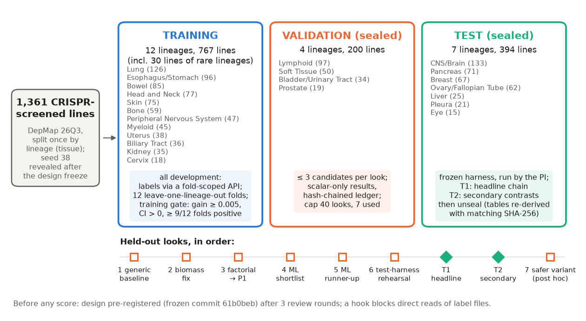
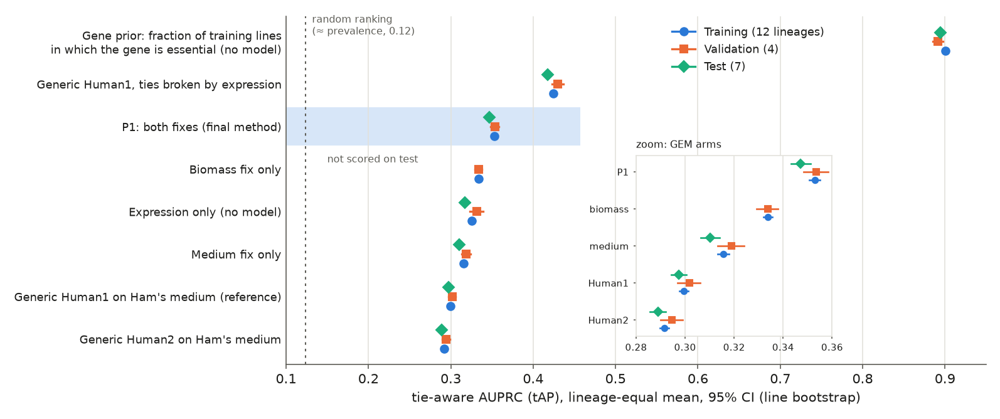
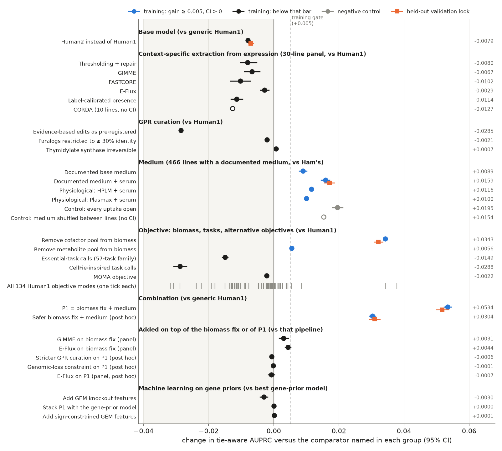
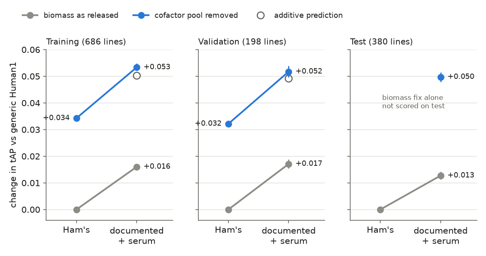
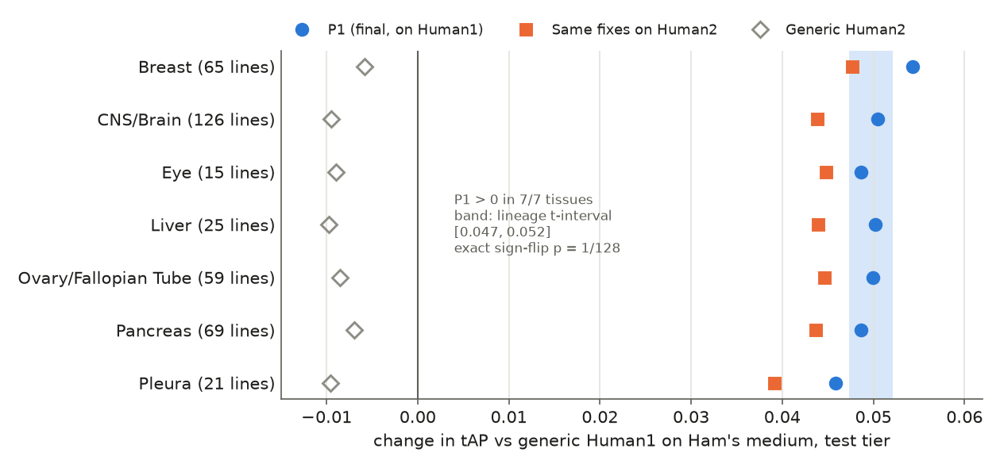
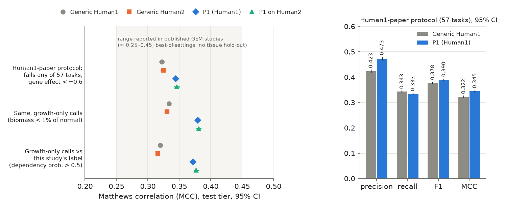
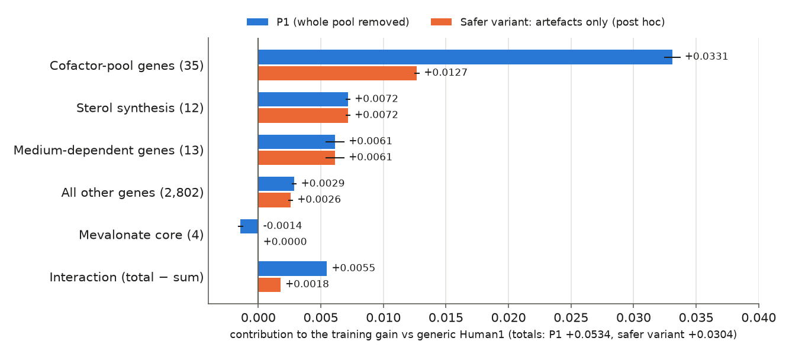
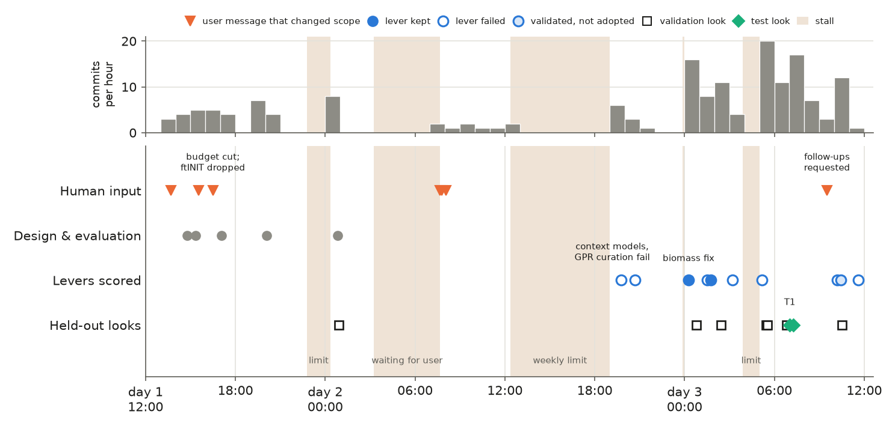

# Can a human metabolic model predict which genes a cancer cell needs? A pre-registered benchmark run by an AI research team

*Research briefing on the nextgem project (Human1/Human2 genome-scale metabolic models against DepMap 26Q3 CRISPR screens), 26–28 October 2026.*

> **Read first.** This briefing was written by the AI agent that acted as principal investigator (PI) of the project. The human-written disclaimer at the top of the repository's [README.md](../../README.md) applies to everything here. In short: the project assesses the bioinformatics abilities of agentic AI (Beltrao-lab hackathon, ETH Zurich, with INESC-ID and IST Lisboa); results were produced by AI with minimal human intervention, **none has yet been verified by a human**, and it is not a traditional publication. The disclaimer also names "metabolic synthetic lethal interactions" as a goal; no analysis addressed synthetic lethality, so no claim is made about it.
>
> **Sources.** Every number comes from a file committed to this repository, cited as a bracketed path. "Shown" means measured in a committed result; "believed" marks interpretation. Figures are regenerated from committed files by `make_briefing_figures.py`, next to this file.

---

## 1. Summary

**Question.** Genome-scale metabolic models (GEMs) can simulate knocking out every metabolic gene and predict which knockouts stop growth. Can the two current human GEMs, Human1 and Human2, be changed so that these predictions better match the genes cancer cell lines depend on in DepMap CRISPR screens, in tissues never seen during development?

**How.** An AI "PI" agent planned the work, pre-registered the design and delegated building and checking to about sixty subagents. The 1,361 screened lines were split once by tissue of origin into 12 training, 4 validation and 7 test lineages, with validation and test labels sealed behind logged, rationed evaluations. Accuracy was a tie-aware area under the precision–recall curve (tAP), always reported next to cheap baselines that use no model.

**What worked.** Only two changes passed training and held up on held-out tissues. Both change predictions the same way in every cell line:
1. remove a small pool of vitamin and cofactor derivatives from the model's growth ("biomass") reaction;
2. let the model take up only what a realistic culture medium with serum supplies, instead of a nucleoside-rich test medium.

The resulting pipeline, **P1**, raised tAP on the 7 held-out test tissues from 0.297 to 0.347: **+0.050 [95% CI 0.048, 0.051]**, positive in **7 of 7** tissues (conditional on these 7 tissues), and +0.037 after removing genes essential almost everywhere [results/m6/test/test_look_T1_gates.json]. Pooled over all gene × line pairs ("overall"), tAP rose from 0.295 to 0.346 [REPORT.md §4.10]. The gain was the same on training (+0.053) and validation (+0.052) [results/m6/train/summary.json; results/m6/val/val_look_M6_factorial_decision.json].

**What did not work.** Every tested way of adding data or curation failed: five families of expression-based model extraction plus CORDA, evidence-based curation of gene–reaction rules, genomic-loss constraints, and model outputs as machine-learning features. Simulated flux states carried no information beyond the omics and the medium.

**Critical caveats.**
- **The gain is modest and generic.** P1 holds no detectable line-specific information: for a given gene, expression ranks the cell lines better than P1 does (pre-registered test failed, −0.011), and a medium shuffled between lines keeps 97% of the medium's gain.
- **A gene-frequency prior scores about 2.6 times P1's tAP (three times the generic model's).** The fraction of training lines in which a gene is essential, which uses no model, scores 0.895 on test; P1 closes only 8.3% of the gap. Breaking the generic model's ties by expression (0.418) also beats P1.
- **Part of the gain may be a good fit to the screen rather than good biology.** About 0.020 of the 0.053 training gain comes from un-calling 20 genuine cofactor-synthesis genes (heme, coenzyme Q, BH4, B vitamins) that DepMap rarely finds essential. Why they are rarely essential is open.
- **P1 has a known error.** It predicts that the mevalonate-pathway genes (HMGCR, MVK, PMVK, MVD) are dispensable when serum is present; DepMap finds them often essential. A safer variant fixes this at a validated cost of about 0.021.
- **Some controls came after the results**, including the control that supports the biomass fix; post-hoc analyses are labelled below.

**As agentic science.** Pre-registration, independent recomputation by non-author agents and mechanised leakage guards kept the claims small and caught real errors. All known label exposures are logged; none is known to have reached P1, but absence of leakage is not proven. The project took 46 h elapsed (≈ 33 h excluding stalls) against a 1–1.5-day compute target, which compute met (§11.3).

---

## 2. Why this question

### 2.1 Metabolic models and simulated knockouts

A **genome-scale metabolic model (GEM)** is a curated network of the chemical reactions a cell can run. Each reaction is linked to the genes encoding its enzymes by a **gene–protein–reaction (GPR) rule**, a Boolean statement: "subunit A AND subunit B" for a complex, "isozyme A OR isozyme B" for alternative enzymes. **Human1** is Human-GEM v1.19.0, the last 1.x release (2,887 genes), descended from the consensus model of Robinson et al. [1]. **Human2** is Human-GEM v2.1.1 (2,870 genes), whose GPRs were re-curated with help from large language models [2] [LITERATURE.md §0, §1].

**Flux balance analysis (FBA)** [3, unverified] finds reaction rates (fluxes) that maximise one objective under limits on what the cell may take up. The usual objective is the **biomass reaction**, a pseudo-reaction that consumes the building blocks of a new cell (amino acids, nucleotides, lipids, cofactors) in fixed proportions; its flux stands in for growth. A **knockout** switches off every reaction whose GPR rule becomes false when a gene is removed; the model is then re-optimised. A gene is **called lethal** when knockout growth falls below 1% of normal growth, and each gene gets a score e = 1 − (knockout growth / normal growth), from 0 (no effect) to 1 (lethal) [docs/explainer/method.md, Terms and Step 4].

### 2.2 What counts as "truly essential"

**DepMap** (the Cancer Dependency Map) knocks out every gene with CRISPR in over a thousand cancer cell lines (1,361 screened in release 26Q3) and measures how much each knockout slows growth [4]. Its **Chronos** model converts guide-level read counts into a per-gene **gene effect**, corrected for knockout efficiency and copy number, on a scale where 0 is the median non-essential and −1 the median essential gene [5] [LITERATURE.md §2.2]. The primary label here calls a gene **essential** in a line when DepMap's **dependency probability** exceeds 0.5; gene-effect cut-offs of −0.5, −0.6 and −1 served as sensitivities and for comparability [REPORT.md §2].

### 2.3 What was known

Published comparisons of GEM knockouts with CRISPR screens report **Matthews correlation (MCC)**, a correlation between binary predicted and observed calls that stays honest when one class is rare, of about 0.25–0.45. These are usually the best of many settings, none with whole tissues held out [LITERATURE.md §0 item 2, §2.1]. The Human1 paper scored context-specific (tINIT) models, calling a gene essential if its knockout failed any of 57 "essential metabolic tasks" [1]; the Human2 paper reports Human2 beating Human1 in MCC with ftINIT models [2]. Two warnings shaped the design: pooled metrics are inflated by gene identity (one predictor reports ROC 0.94 on random gene–line pairs but 0.61 per gene [6]), and context-specific extraction tends to produce models that cluster by method rather than tissue [7, 8]. The brief asked for AUPRC (essential genes are a small minority) per gene, per lineage and overall, with whole lineages withheld [PROMPT.md].

---

## 3. The agentic set-up

### 3.1 Who did what

The project ran in Claude Code. A main agent (Claude Opus) acted as **PI**: it wrote and froze the design, took every decision (D0–D19 in [RESEARCH_TREE.md]), made every commit (per commit authorship), ran every held-out evaluation and kept the research record. Everything else went to subagents: 56 before the write-up phase (42 Opus, 14 Sonnet) plus four follow-up engineers. Roughly half built (workstream engineers, authors of the evaluation **harness**, i.e. the scripts that score held-out data, and the report drafter) and half checked (design reviewers, code reviewers, non-author recomputers, process reviewers, and an agent that re-derived blind the **a priori gene lists**, the positive and negative control genes fixed before any scoring). These counts come from the session transcript as summarised in the explainer, not from a committed result [docs/explainer/journey.md, "The research process"; docs/explainer/discrepancies.md §C].

### 3.2 Pre-registration and independent critique

**Pre-registration** means fixing hypotheses, metrics, split, decision rules and claim wording before seeing any outcome, so the analysis cannot drift towards whatever looks best. Seven reviewer agents (external PI, statistics, data, algorithms and compute, prior work, cancer metabolism, AI-agent failure modes) critiqued the PI's DESIGN.md over three rounds, then a verifier who had never seen label data checked it. The rounds produced 51 PI decisions, and the design was frozen at commit 61b0beb [RESEARCH_TREE.md tree items 2.1–2.6]. Later changes were logged as 15 dated amendments [DESIGN.md §17].

### 3.3 Leakage guards

**Leakage** is when information about the answers seeps into model building, inflating apparent accuracy [9]. Guards were mechanisms, not instructions:
- a hook in the agent software blocks any direct read of DepMap label files, and every agent session began with a probe confirming the block;
- labels were served only through one module, per cross-validation fold, backed by a **tripwire** (a runtime check that refuses label access to unapproved code);
- sealed validation and test labels could be read only by frozen evaluation scripts; each validation **look** (one logged evaluation run) returned summary numbers only, was capped at 40 in total, and was recorded in a hash-chained ledger that cannot be silently edited;
- code and inputs were pinned by SHA-256 checksums, and every agent that saw label summaries was recorded [README.md "Leakage controls"; notes/label_exposure.md].

### 3.4 Human checkpoints

The user intervened rarely, but decisively [docs/explainer/journey.md, "Where human input changed direction"]:
- approving the label-guard hook;
- cutting the compute target ("5–6 days compute is too much"): per-line ftINIT models were dropped (the user's own analysis showed them below the generic model), the generic model became the sole comparator, and the budget fell from about 2,950 to 1,020 CPU-hours [DESIGN.md §13; RESEARCH_TREE.md D2];
- supplying the split seed, keeping CORDA as a 10-line comparison, and suggesting GPRTransform [10];
- ordering a blind re-derivation of the a priori gene lists after the PI relaxed an authorship rule post hoc;
- requesting four follow-ups after the test.

No user message steered the biomass or medium work; the content of P1 came from the agents.

*Figure 1. The benchmark design. 1,361 CRISPR-screened lines were split once by lineage with a seed revealed only after the design was frozen. All development used training lineages, with labels served per cross-validation fold; validation and test labels were sealed. The bottom row lists every held-out evaluation in time order: seven validation looks (squares; the seventh is a post-hoc follow-up) and two test looks (diamonds). Lineage sizes are screened lines. Scored lines are those with expression data: 686 lines in the 12 named training lineages, 198 validation, 380 test. Sources: results/splits/split_summary.tsv, results/splits/split_meta.json, results/validation_ledger.tsv, results/test_ledger.tsv.*

---

## 4. Building the benchmark

### 4.1 Data and labels

The inputs were Human-GEM v1.19.0 and v2.1.1 and DepMap Public 26Q3 (CRISPR, expression, copy number, mutations, metadata and each screen's culture medium); proteomics, metabolomics and drug screens entered secondary analyses only [REPORT.md §2; DATA.md]. The gene universe was the 2,866 Human1 or Human2 genes with a CRISPR measurement. The primary label (dependency probability > 0.5) agreed with the gene-effect < −0.5 label at Cohen's κ = 0.934 on training (κ is agreement corrected for chance; 1 is perfect), above the pre-registered threshold for keeping it [REPORT.md §2].

### 4.2 Holding out whole tissues

A **lineage hold-out** keeps entire tissues of origin out of development, so a gain must transfer to tissues the method has never seen; a random split would put lines of the same tissue on both sides. The split drew 7 test lineages (CNS/brain, pancreas, breast, ovary/fallopian tube, liver, pleura, eye; 394 lines), 4 validation lineages (lymphoid, soft tissue, bladder/urinary tract, prostate; 200 lines) and 12 training lineages plus 30 lines from rare lineages (767 lines) (Figure 1) [results/splits/split_summary.tsv]. Seven test lineages were required so that "positive in every test tissue" could reach significance by an exact sign-flip test, which asks how often randomly flipping the signs of the per-tissue gains gives a result as extreme (minimum p = 1/2⁷ = 1/128) [docs/explainer/journey.md TP1]. The first seed was retired after a reviewer ran it and published its test tier; the user supplied a new one, which the PI kept out of files and prompts until after the freeze (a **commit-reveal**), apart from one slip in an unpushed commit that was amended away [RESEARCH_TREE.md D4].

### 4.3 The metric, and why ties matter

**AUPRC**, the area under the precision–recall curve, computed per line as **average precision (AP)**, asks how well a ranked gene list puts the essential genes first; a random ranking scores about the fraction essential, here about 0.12. It suits rare positives better than ROC curves [11].

The design reviewers found a trap: FBA knockout scores are nearly binary (about 2,650 of 2,870 genes have no effect in the generic model), and standard AP software orders ties arbitrarily. On synthetic data shaped like FBA output, random tie-breaking alone moved AP by 0.025–0.053 per line [notes/design_review_r1/statistics.md, via docs/explainer/journey.md TP1], and floating-point noise between identical runs by up to 0.018 [notes/milestone_reviews/M1_process_review.md]. The project therefore used:
- **tie-aware AP (tAP)**: the exact expected AP when tied genes are placed in random order, following McSherry & Najork [12] (a citation LITERATURE.md flags as not verified against the publisher record);
- **rounding** of knockout ratios to 6 decimals, which made reruns bitwise identical;
- **lineage-equal averaging** of per-line tAP, so large tissues do not dominate.

### 4.4 Baselines that expose free gains

Three cheap baselines were mandatory in every comparison [REPORT.md §3.2]: the **gene prior** (the fraction of training lines in which the gene is essential; labels, no model); **expression only** (genes ranked by mRNA level in the line); and the **expression tie-break** (the generic model's scores with ties broken by expression), which measures what any pipeline gains merely by ordering the tied block.

### 4.5 Endpoints, smallest effect of interest and gatekeeping

The primary endpoint was the lineage-equal mean change in tAP of the final pipeline over the **reference** (the generic model on Ham's medium; Human1 or Human2, to be chosen by the first validation look) on the 7 test lineages. A second endpoint removed genes essential in ≥ 90% of the lines used for fitting, because such **common essentials** make up most positives (86.5% at gene effect < −0.5) [REPORT.md §1; docs/explainer/method.md Terms].

The **smallest effect size of interest (SESOI)** is the smallest improvement worth calling meaningful, fixed in advance: 0.01 tAP (0.0057 without common essentials). Claim wording was tiered by it [REPORT.md §1]: "detectable improvement" if the test passes, "improves" if the point estimate reaches the SESOI, "meaningfully improves" if the CI lower bound does, and "generalises to new tissues" only if a lineage-level interval excludes zero and at least 5 of 7 test tissues are positive. Confirmatory tests ran in a fixed order (**gatekeeping**): headline, then without common essentials, then line specificity, then two secondary contrasts, each one-sided at α = 0.025. A failure turns all later tests into estimates.

To earn a validation look, a fix had to pass a **training gate**: a mean gain of at least 0.005, a bootstrap confidence interval (from resampling cell lines within lineages) that excludes zero, and a gain in at least 9 of the 12 **leave-one-lineage-out folds** (each training tissue held out in turn). At most three candidates entered one look. If several passed, the simplest was kept unless a more complex one was better by more than one standard error. Picking the best of several candidates flatters the winner, so each look also reported the expected size of that flattery (the **winner's curse**), which grows with the number of candidates [REPORT.md §1].

---

## 5. The generic models, and the sobering baselines

**Question.** Which generic model is the reference, and how much room is there to improve? Human2 was the default: newer, and its paper reports gains over Human1 [2].

**Evidence.** Human1 beat Human2 in all 12 training lineages (tAP 0.300 vs 0.292) and in the single validation look (−0.0071 [−0.0079, −0.0063]), which fixed generic Human1 as the reference [results/w1/train_grid.tsv; results/w1/val_look_W1_M2_baseline_gstar.json]; it also led in every test lineage (−0.0084 for Human2) [REPORT.md §4.10]. Under the Human1 paper's MCC protocol the two were tied (0.329 vs 0.331). The Human2 paper's advantage was not reproduced; its protocol differs (context-specific models, MCC, older labels).

**The sobering part** (Figure 2). On training lineages [REPORT.md §4.1] the gene prior scored **0.900**, three times the generic model (0.300); expression alone (0.326) beat both generic models; and breaking the generic model's ties by expression gave **0.424**, a free +0.12. About **45%** of essential gene × line pairs involve genes whose knockout changes nothing in Human1 (Human2: 42%) [results/w1/train_addressable.tsv]. No FBA variant can rank those genes: this **addressable-set ceiling** bounds any GEM's recall (on test, only 54.7% of positives lie in addressable genes) [REPORT.md §6].

**Choice.** Generic Human1 became the reference and base, and every later result was read against the gene prior and the expression tie-break too [LESSONS.md].

*Figure 2. Accuracy of each pipeline and baseline on the three tiers (lineage-equal tAP, 95% line-bootstrap CI). The GEM pipelines span 0.29–0.35. The gene prior sits near 0.9 and the generic model with an expression tie-break near 0.42, both well above the final method P1. The inset zooms on the GEM arms; the dotted line marks a random ranking. The biomass fix alone was not scored on test. Sources: results/m6/train/cells.tsv, results/w1/train_grid.tsv, results/m6/val/val_look_M6_factorial.tsv, results/w1/val_look_W1_M2_baseline.tsv, results/m6/test/unsealed/T1/w1_benchmark.tsv.*

---

## 6. Changing the model, one lever at a time

The brief named four levers: context-specific models, the medium, biomass and tasks, and GPR curation. Each was screened on training lineages against the training gate (Figure 3).

*Figure 3. Every lever tried, as the change in tAP against the comparator named in each group (95% CI; hollow markers have no CI). Blue: training gain ≥ 0.005 with CI above zero. Black: below that bar. Grey: negative controls. Orange squares: the same lever in a held-out validation look, where one was spent on it. The medium group is scored on the 466 training lines with a documented medium, against Ham's; its validation square is the factorial "medium only" cell against the reference on all validation lines. The metabolite-pool leave-out cleared the bar but was withdrawn before validation (§6.3). The strip shows all 134 Human1 objective modes (72 on Ham's medium, 62 on an RPMI proxy): the two ticks far to the right are the same cofactor-pool leave-out on the two media (+0.034 and +0.038). Sources: listed in briefing_figure_data.json (fig3), all committed results files.*

### 6.1 Context-specific extraction: every family loses

**Question.** Does tailoring the network to each line's expression improve prediction? This was the centre of the original brief.

**Options.** On a 30-line training panel, five families at three expression thresholds, with RNA or protein and with or without a genomic-loss constraint: thresholding with repair, GIMME [13], FASTCORE [14], E-Flux [15] (which scales reaction bounds by expression instead of removing reactions) and a "label-calibrated presence" model; CORDA on 10 lines at the user's request. This took 1,380 builds and 108.7 CPU-hours, the largest compute block [REPORT.md §4.2].

**Evidence.** All families lowered tAP against the generic model [results/w4/stage_a_analysis/train_selection.json; results/w4/stage_a_analysis/train_corda_a6prime.tsv]:

| Family | Change in tAP vs generic Human1 |
|---|---|
| Thresholding + repair | −0.0080 |
| GIMME | −0.0067 |
| FASTCORE | −0.0102 |
| E-Flux | −0.0029 |
| Label-calibrated presence | −0.0114 |
| CORDA (10 lines, descriptive) | −0.0127 |

Less pruning was always better, and the genomic-loss constraint changed tAP by at most 0.0002. The extraction method explained more variance in knockout profiles than tissue did (R² 0.199 vs 0.085) [results/w4/stage_a_analysis/h4_tests.json], reproducing at DepMap scale the "method over tissue" finding of Opdam et al. [7] and Richelle et al. [8]. A non-author agent recomputed all of this [notes/reviews/M3_W4_stageA_review.md]. On top of the biomass fix (§6.3), GIMME and E-Flux added +0.0031 and +0.0044, below the bar [results/m5/train/train_decision.json]; post hoc, E-Flux on the full P1 gave −0.0007 [results/f4/README.md].

**Choice.** No extraction. The planned lineage and genomic-background group models were never run: untested, not refuted. **Believed:** expression pruning removes correct generic calls faster than it adds line-specific ones.

### 6.2 GPR curation: loses, with a lesson about RNA polymerase

**Question.** Wrong GPR rules are a documented error source; Human2's gains are attributed to fixing spurious "OR" isozymes [2]. Do evidence-based edits help? The pre-registered edits merged Ensembl paralogs that share no complex (AND→OR; paralogs can buffer each other [16]), required co-complex members jointly (OR→AND), removed branches absent pan-cancer, and refined by co-essentiality.

**Evidence.** Curation lowered tAP by **−0.029** on both models, in 0 of 12 folds, worse than matched random edits (−0.006 to −0.015) [results/w5/train_summary.json; REPORT.md §4.3]. The paralog rule had merged distant RNA polymerase I, II and III subunits (21–25% protein identity) inside Human1's single lumped "RNA synthesis" pseudo-reaction, making 15 POLR genes non-lethal. Restricting merges to paralogs with ≥ 30% identity cut the loss to −0.002, still no help.

**Post-hoc check.** A stricter rule, applied on top of P1 and excluding lumped, large-complex and transport reactions, still lost (−0.0006, 0/12 folds) [results/f1/README.md]. Its only effective edit merged RRM2 with RRM2B, making RRM2, essential in 99.7% of test lines, non-lethal [results/m6/test/unsealed/T1/per_gene.tsv, via docs/explainer/method.md Step 1].

**Choice.** GPRs as released. A one-CPU-hour, label-free scan for lumped reactions would have predicted the failure [notes/milestone_reviews/M3M4_process_review.md]. A side finding fed the next lever: CAD stays lethal under uridine only because dihydroorotate sits in a biomass **metabolite pool** (a second pseudo-metabolite in the biomass reaction that bundles small metabolites) [RESEARCH_TREE.md item 7.1].

### 6.3 Biomass and tasks: removing the cofactor pool wins

**Question.** Are many false "essential" calls created by what the model is asked to achieve, rather than by missing context?

**Options.** 134 pre-registered "objective modes" per model (72 on Ham's medium, 62 on an RPMI proxy) [results/w3/README.md; REPORT.md §4.5]: task requirements (the Human1 paper's 57 essential tasks; a set inspired by CellFie [17], a published list of cell functions); alternative objectives such as MOMA [18] (which predicts the knockout state closest to the normal one rather than the fastest-growing) and an ATP maintenance cost; biosynthetic demands; additions to biomass; and **biomass leave-one-out**: delete one reactant or reactant group from the biomass reaction and see which calls change.

**Where the idea came from.** Leave-one-out was in the first design draft as a *diagnostic*. Three label-free observations during other work made it a candidate *fix* [docs/explainer/journey.md TP5]: naive expression pruning killed growth through "biomass-artefact lethals" (vitamin-catabolising cytochrome P450s, carnitine synthesis); serum cholesterol rescued only one sterol gene, because the biomass demands vitamin-D catabolites reachable only through 7-dehydrocholesterol; and the dihydroorotate finding above. Published work had warned that biomass composition changes essentiality predictions (Moscardó García et al. [19]; Tobalina et al. [20]).

**Evidence.** One of the 9 reactants of Human1's biomass reaction, as released in Human-GEM [1], is a pseudo-metabolite, the **cofactor pool** (coefficient 0.0012), assembled from 38 species: 20 retinoid, 4 vitamin-D and 2 tocopherol catabolites, carnitine, heme, ubiquinol, lipoate, cobamide and seven B-vitamin-type cofactors [docs/explainer/method.md Step 2]. However small the coefficient, any gene needed to make one of them is lethal in the model, and several are degradation products that (believed) a dividing cell does not need for growth. Removing the pool passed the training gate at **+0.034 [0.034, 0.035]**, 12/12 folds (Human2 +0.037) [results/w3/train/mode_scores.tsv], and in validation look 2 (198 lines, 4 new tissues) gave **+0.032 [0.031, 0.033]**, the first fix to beat the reference on held-out tissues [results/w3/val/val_look_W3_M4_shortlist_decision.json]. Task-based calls lowered all-gene tAP (57-task family −0.015, CellFie-inspired −0.029) and objectives did essentially nothing (MOMA −0.002).

**The control problem, plainly.** Each mode was to be compared with a pre-registered negative control: give the same number of *extra* "lethal" calls to the genes with the highest gene prior, and check the mode beats that. This control only makes sense for modes that add calls; a leave-out removes calls. The engineer first invented its own mirror-image control (remove the calls with the lowest gene prior), under which nothing qualified. After seeing those training numbers, it switched to the literal reading: no control applies to leave-outs, so they qualify on the gate alone. The independent reviewer accepted that reading, noted that the engineer's control was nearly an oracle (it used the 0.90 gene prior), and stated that "no claim may rest on 'beats controls'". The fix also loses to that gene-prior-informed comparator (−0.020). The reviewer then added a **post-hoc**, label-free control: removing the same number of *random* calls lowers tAP by 0.028, so the targeted removal beats random by +0.062 [notes/reviews/M4_W3_review.md §2]. Every P1 claim carries the flag "control reading fixed after results were seen". With 134 modes, the expected flattery of the best one (0.049) exceeded every training effect [REPORT.md §4.5], so the held-out validation look, not the training screen, is what supports the fix; for the same reason the metabolite-pool leave-out (+0.0056) was withdrawn before validation.

**Choice.** Remove the cofactor pool; score by growth only, not task failure.

### 6.4 Medium: wins, but not line-specifically

**Question.** The Human-GEM test medium, Ham's (the 44 inputs of its "growth on Ham's" task), contains hypoxanthine and thymidine, which let the model bypass de novo purine and pyrimidine synthesis. Medium is a known confounder of metabolic dependency: in DepMap it is associated with dependency for 26% of variable metabolic genes, against 3% of other genes [21]. Does each line's documented medium improve predictions, and is the gain line-specific?

**Options** [results/w2/README.md]: the documented base medium (extracted blind by two agents, who agreed on 312 of 313 components); base medium plus a serum model (fatty acids, cholesterol, carnitine, ethanolamine, trace metals); calibrated uptake rates; and the physiological media HPLM [22] and Plasmax [23]. Negative controls: every uptake open, and media shuffled between lines of the same lineage and serum status.

**Evidence** (466 training lines with a documented medium) [results/w2/train/step_scores.tsv; results/w2/train/shuffled_control.tsv]. Documented medium + serum gained **+0.016 [0.015, 0.017]** (11/12 folds); base medium alone +0.009; HPLM +0.012 and Plasmax +0.010; calibrated rates were infeasible (growth tracked only the oxygen bound). **A shuffled medium kept 97% of the gain** (documented − shuffled = +0.0005 [−0.0000, 0.0010]), and, post hoc, one constant medium (RPMI + 10% serum) scored slightly higher (+0.0015). Opening every uptake scored +0.020 on all genes but −0.017 without common essentials: it mainly un-calls genes.

The genes that move are generic. Dropping Ham's nucleosides makes 8 de novo nucleotide genes lethal (ATIC, GART, PAICS, PFAS, PPAT, TYMS, DHODH, UMPS), essential on average in 44% of test lines; serum carnitine, cholesterol and the medium's glutathione rescue 13 calls essential in only 16% [docs/explainer/data/gene_groups.tsv]. This matches physiological-medium CRISPR screens, in which purine-synthesis genes were RPMI-essential, likely because HPLM supplies hypoxanthine [24], and the *E. coli* finding that false essential calls arise from nutrients available to mutants despite being absent from the nominal medium [25]; the serum model is the human analogue (an inference recorded in LITERATURE.md §4.1). "Documented" is also narrower than it sounds: 485 of 1,361 screened lines receive classic RPMI + 10% serum by default (medium missing, unmappable or imputed), and 1,050 share one classic-RPMI model [results/m6/scores/line_assignment.tsv, via docs/explainer/discrepancies.md A6].

**Choice.** The pre-registered selection rule picked the documented medium plus serum; the constant medium was a post-hoc comparison and could not replace it. It is described as "a realistic culture medium with serum instead of Ham's", flagged as not line-specific.

### 6.5 Flux information: null

**Question.** Do simulated fluxes carry information the input omics do not, for cancer subtypes (150 classification tasks), metabolic drug sensitivity (106 drug-and-screen units) or metabolite levels (225)?

**Evidence.** Adding flux or knockout profiles to RNA gave no gain in any (all p ≥ 0.38 after Holm correction for multiple testing), though a synthetic positive control was recovered [REPORT.md §4.11; results/w6/provisional/analysis/decisions.tsv]. A generic model's flux depends only on its medium, so 77 of 106 drug units changed by exactly 0. **Conclusion:** the null is a property of models that do not differ between lines, not a verdict on flux analysis in general.

### 6.6 Machine learning with GEM features: no gain

**Question.** Can model outputs help a machine-learning predictor that already knows gene priors?

**Evidence.** An automated-research loop logged 17 ideas in advance, scored 15 and stopped after 10 consecutive failures [autoresearch/results.tsv]. The best gene-prior model was **gradient boosting** (an ensemble of decision trees) on priors, omics and medium (training tAP 0.889). Adding GEM knockout features gave −0.003; **stacking** (feeding P1's scores to the model as an extra input) +0.000. The one promoted idea, a **monotone constraint** forcing predictions to rise with the gene prior, contains no model output; its training lead of +0.014 shrank to +0.0007 on validation, which a pre-registered runner-up comparison caught [REPORT.md §4.12]. **Conclusion:** the best overall predictor (P2) is a non-GEM model.

---

## 7. Selecting and testing P1

### 7.1 The factorial

The PI pre-declared three candidates: medium only, biomass fix only, and both. A reviewer noticed that the PI's first candidate order contradicted the design's "simplest first" rule; it was corrected before any validation scoring [notes/reviews/M6_harness_and_spec_review.md].

**Evidence** (Figure 4) [results/m6/train/summary.json; results/m6/train/interaction.tsv; results/m6/val/val_look_M6_factorial_decision.json]. Training: medium +0.016, biomass +0.034, both +0.053, all 12/12 folds, slightly more than additive (+0.0031 [0.0027, 0.0034]). Validation look 3: medium +0.017, biomass +0.032, both **+0.052 [0.050, 0.054]**; only "both" was within one standard error of the best, and the expected winner's-curse inflation was 0.0015.

**Choice.** **P1 = generic Human1 + cofactor pool removed from biomass + documented medium with serum.** P1 has no fitted parameters, although its edit was selected from 134 modes on training labels.

*Figure 4. The two fixes alone and together. Grey: biomass as released; blue: cofactor pool removed; left and right of each panel: Ham's medium vs documented medium with serum. The hollow circle is the additive prediction. The pattern repeats on validation. On test, the medium alone gives +0.013 and both together +0.050; the biomass fix alone was not scored on test. Sources: results/m6/train/summary.json, results/m6/train/interaction.tsv, results/m6/val/val_look_M6_factorial_decision.json, results/m6/test/unsealed/T1/attribution.tsv.*

### 7.2 The test

A rehearsal of the frozen test harness on validation reproduced the factorial look's +0.0517 exactly [REPORT.md §3.13]. The test tier was opened once for the confirmatory chain (look **T1**) and once for the secondary contrasts (**T2**); the sealed tables were then published after re-deriving all 11 with matching checksums [RESEARCH_TREE.md D15–D16].

**Confirmatory results** [results/m6/test/test_look_T1_gates.json; results/m6/test/test_look_T2_gates.json; REPORT.md §4.8]:

| Test (pre-registered order) | Estimate [95% CI] | Outcome |
|---|---|---|
| Headline: P1 − reference, all genes | **+0.0497 [0.0482, 0.0513]**, sign-flip p ≤ 10⁻⁴ | Confirmed; "meaningfully improves" (CI lower bound > SESOI 0.01) |
| Same, without common essentials | +0.0374 [0.0351, 0.0397] | Confirmed; "meaningfully improves" |
| Line specificity: P1's ranking of lines per gene vs expression | −0.0114; permutation p = 0.64 | **Failed** |
| P2 − reference (non-GEM ML) | +0.602 [0.598, 0.605] | Estimate only (chain stopped) |
| P2 − pre-registered ML baseline | +0.0138 [0.0116, 0.0167] | Estimate only |

The headline p is the smallest attainable with 10,000 sign flips. The line-specificity interval [−0.0183, −0.0115] oddly excludes its point estimate (cause unknown), but both of its criteria fail independently [REPORT.md §4.8].

**Transfer to new tissues** (Figure 5). P1 gained in **7 of 7** test lineages, from +0.046 (pleura) to +0.054 (breast); the lineage-level t-interval was [0.047, 0.052] and the exact sign-flip p = 1/128, so "generalises to new tissues" holds, conditional on these seven tissues [results/m6/test/unsealed/T1/per_lineage.tsv]. The gain did not shrink across tiers (+0.053, +0.052, +0.050).

**Robustness** [results/m6/test/unsealed/T1/sensitivities.tsv; results/m6/test/unsealed/T1/strata.tsv]. The gain holds at gene-effect labels < −0.5 (+0.050) and < −1 (+0.047), in every CRISPR library (+0.041 to +0.052) and in organoids (+0.036), but is **negative (−0.012)** on genes with known non-metabolic "moonlighting" functions.

**Against the baselines** [results/m6/test/test_look_T1.tsv]. P1 loses to the expression tie-break (−0.071), so "adds information beyond generic model + expression" is **not** claimed, and to the gene prior (−0.548), closing **8.3% [8.1%, 8.6%]** of the gap between reference and prior. P2 reaches test tAP 0.899 against 0.895 for the plain gene prior.

*Figure 5. Gain in tAP over the reference in each held-out test tissue (scored lines in brackets). Blue: P1. Orange: the same two fixes on Human2. Grey diamonds: generic Human2, below Human1 in every tissue. The shaded band is the lineage-level t-interval for P1. Sources: results/m6/test/unsealed/T1/per_lineage.tsv, results/m6/test/test_look_T1_gates.json.*

---

## 8. Paper-protocol metrics, for comparability

The user asked for MCC and F1 under the Human1 and Human2 papers' protocols [RESEARCH_TREE.md D2]. Calls followed those papers (a gene is essential if its knockout fails any of 57 metabolic tasks, or, growth-only, if growth falls below 1%), against gene effect < −0.6, the Human1 paper's threshold, applied here to Chronos scores rather than the older CERES scores that paper used. On test (Figure 6) [results/m6/test/test_look_T1.tsv; REPORT.md §4.9]:
- **57-task calls:** MCC 0.322 for the reference, 0.345 for P1 (Human2 0.325; P1 built on Human2 0.346).
- **Growth-only calls:** 0.334 → 0.379; against this study's label, 0.320 → 0.372.
- **Components (57-task):** precision rose from 0.423 to 0.473 while recall fell from 0.343 to 0.333; F1 went from 0.378 to 0.390. P1 mainly removes false positives; it does not find new true essentials.

All values lie inside the published range of about 0.25–0.45, but comparability is in protocol only (no per-line context models, different label scale), so they should not be read as beating or matching published values [REPORT.md §7].

*Figure 6. Binary metrics on the test tier under published protocols (lineage-equal means, 95% CI). Left: MCC for the generic models and P1 under three call/label rules, on an axis from 0.2 to 0.5; the shaded band is the range of MCCs reported in published GEM studies (≈ 0.25–0.45, best-of-settings, no tissue hold-out). Right: precision, recall, F1 and MCC under the Human1-paper 57-task protocol, with 95% CIs. P1 raises precision and lowers recall slightly. Source: results/m6/test/test_look_T1.tsv.*

---

## 9. What the improvement is made of

### 9.1 Decomposition by gene group (post hoc, training)

After the test, the user asked for follow-ups, run on training and validation only and labelled post hoc [DESIGN.md §17 A15]. One decomposed P1's training gain by gene group, each group's contribution being the tAP change when only its scores differ from the reference (Figure 7) [results/f2/decomposition.tsv]. **Un-calling the 35 cofactor-pool genes gives +0.033, 62% of the gain.** Sterol genes rescued by serum cholesterol once the vitamin-D demand is gone add +0.007, medium-dependent genes +0.006, all other genes +0.003 and the interaction +0.005. **The mevalonate core costs −0.0014**: P1 does not profit from its known error.

The 35 un-called genes are rarely essential in DepMap: on average in 14% of test lines (median 1.6%), against 73.5% for genes P1 still calls lethal [docs/explainer/data/gene_groups.tsv]. They fall into two groups with similar means but different medians:
- 15 genes un-called by removing only the catabolites and carnitine (e.g. CYP26A1, BBOX1): mean 13%, median 0.3%. The mean is driven by SPCS2 and SPCS3, signal-peptidase genes essential in 93–94% of test lines whose link to the pool was never traced [docs/explainer/discrepancies.md §B5];
- **20 genes that make real cofactors**, such as heme (HMBS, UROD), coenzyme Q (COQ2, COQ3), BH4 (GCH1, PTS, SPR) and B vitamins (PDXK, TPK1, RFK): mean 15%, median 3.4%.

A model call that is the same in every line is in effect a bet on a gene's frequency, and these were bad bets. **Shown:** removing them improves the ranking. **Not shown:** that the biology is right. Real cells must make heme and CoQ. They may escape dependency in a screen through carry-over or uptake from serum that the model omits (the human counterpart of the *E. coli* finding that vitamins and cofactors are "available to mutants despite being absent from the medium" [25]), through slow depletion within the screen, or because a fixed-proportion biomass is too rigid. That the *coefficients* matter little is consistent with Opdam et al., where randomising all biomass coefficients by ±20% did not change essentiality accuracy [7]; what matters is which species are demanded at all. None of these explanations was tested here [docs/explainer/discrepancies.md §B2].

*Figure 7. Where P1's training gain comes from (post hoc). Blue: P1. Orange: the safer variant that removes only catabolites and carnitine. Most of P1's advantage over the safer variant comes from the cofactor-pool row: the safer variant keeps 20 real-cofactor genes lethal. The mevalonate error costs P1 0.0014. Bars: contribution of each gene group (95% CI). Source: results/f2/decomposition.tsv.*

### 9.2 The known error and the safer variant

Ubiquinol (coenzyme Q) is the only use of the mevalonate pathway in the model other than sterols. Once the pool is removed and serum supplies cholesterol, HMGCR, MVK, PMVK and MVD become non-lethal (knockout keeps 98.5% of growth on all 19 serum media) [results/m6/scores/w3_mev.tsv]. In DepMap these genes are essential in 43–90% of test lines, so P1 gets a textbook positive control wrong [docs/explainer/method.md Step 2].

A **safer variant** removes only the catabolites and carnitine and keeps ubiquinol, heme and the real cofactors, so the mevalonate core stays lethal on every medium. In its own validation look (post hoc, look 7 of 40) it gained +0.031 [0.029, 0.033] over the reference, against +0.052 for P1 in the same look: a validated cost of about 0.021 [results/m10/val/val_look_M10_F2_decision.json]. Almost all of the difference (0.020 of 0.023 on training) is the 20 real-cofactor genes [results/f2/decomposition.tsv]. **P1 is the better pipeline on this benchmark. The safer variant is preferable where mevalonate or real cofactor biology matters, at a validated cost of ≈ 0.021 tAP.** For the mevalonate core, the safer variant agrees better with DepMap; for the real-cofactor genes, which call is right is open (§9.1).

### 9.3 The worst errors and line-specific constraints

The pre-registered trace of the 20 worst test errors ran after the test (post hoc, descriptive). All 20 are pan-essential genes P1 calls viable in all 126 CNS/brain lines: 13 have functions Human1 does not represent (translation, N-glycosylation, ubiquitination, mRNA capping), 4 are DNA-polymerase subunits hidden behind a lumped DNA-synthesis reaction with a 17-way OR rule, 2 have alternative routes and 1 is absent from Human1 [results/f3/README.md]; none is fixable through the medium. So the 20 worst errors lie outside what Human1 represents; across the test tier, misses concentrate in complex subunits, common essentials and paralog-buffered genes, where GPR logic and model scope fall short [REPORT.md §6].

Two post-hoc follow-ups tried to give P1 line specificity: removing genes lost by deletion or damaging mutation changed only 22 knockout calls across 665 training lines (−0.0001), and E-Flux bounds on P1 gave −0.0007 [results/f4/README.md].

---

## 10. Deliverable: the SBML resource

Because P1 differs between lines only by medium, the resource ships one model per parent and medium signature, not per line: 48 gzipped models in **SBML** (the standard exchange format for metabolic models), Human1 and Human2 versions of P1 × 24 medium signatures, with a manifest mapping all 2,114 DepMap lines (753 unscreened) to their model [resource/README.md; REPORT.md §5]. 47 of 48 passed all six automated gates (validity, reloading, growth, random knockouts, viability tasks, agreement with the reference sweep); the one miss is a knockout growth of −8 × 10⁻⁹ under default solver tolerances that is exactly 0 in exact arithmetic, i.e. numerical noise of the linear-programming solver [results/w8/ko_noise/human2_20cc933a4b852b6a_summary.json]. **MEMOTE** (a standard model-quality test suite) scored 10 of the models at 0.630 (Human1) and 0.638 (Human2), identical across media. Each model records its provenance and carries P1's flags, including the mevalonate error on the 42 serum-medium models.

---

## 11. The agentic-science view

### 11.1 What worked

- **Evaluation before modelling.** Fixing tie-aware AP, lineage hold-out and cheap baselines before any score made the headline small and believable; without the baselines, +0.05 would read as far more than "8% of the way to a gene-frequency prior".
- **Non-author recomputation** was the core safeguard. Before any held-out look it caught a floating-point tie instability (0.018 in AP) that 36 passing checks had missed, three defects in the context-model code that would have invalidated the 108-CPU-hour screen, the reversed candidate order, and two test-harness bugs, one of which made two endpoints identical in dry runs [notes/milestone_reviews/; docs/explainer/journey.md].
- **A sceptical reviewer made the winning result's limits explicit**, by supplying the random-removal control and finding the mevalonate cost.
- **The tripwire fired once, as designed.** An environment variable that redirects where Python loads code from (`PYTHONPATH`) made the first test rehearsal run code from the wrong directory; the tripwire refused it label access and no look was consumed [RESEARCH_TREE.md note 06:25].
- **Pre-registered order and wording** turned the failed line-specificity test into a reported failure that blocked any personalisation claim.
- **Machine-checked reporting:** REPORT.md's 570 marked numbers are regenerated from source files [REPORT.md §9].

### 11.2 What went wrong, plainly

- **PI errors** [notes/milestone_reviews/M5M9_process_review.md §c; RESEARCH_TREE.md; LESSONS.md]: relaxed the a priori list authorship rule after the fact; leaked the split seed into an unpushed commit; proposed a candidate order contradicting the design; read a wrapper's exit status as the build's; exported `PYTHONPATH` into a ledger-committing process (the **environment leak** above); let the automated-ML runs use uncommitted code (reproduced bitwise by review); added procedural amendments against its own rule; and wrote a **wrong commit message**, "all gates pass", when 39 of 40 models had passed (caught by the report drafter, not the build).
- **Subagent errors** [notes/label_exposure.md; LESSONS.md; REPORT.md §10]: a reviewer left an all-line label copy in shared scratch space (deleted); another ran and published the original split seed (retired); the medium engineer deleted shared files it had not created and committed its scoring code only after its first label-reading run; the extraction engineer sliced training labels outside the fold API (a fold-scoped rerun reproduced every choice); and the biomass engineer changed its **control reading after seeing training results** (§6.3), the most serious deviation.
- **Compute waste:** a solver stall without a time limit cost about 8.5 CPU-hours and a thread-oversubscription incident about 7 [results/w3/README.md; RESEARCH_TREE.md item 8.1].
- **Review overhead:** about 40% of time went to compute, 40% to review and fix rounds, 20% to amendments and bookkeeping (21,000 words of review for about 135 CPU-hours) [notes/milestone_reviews/M3M4_process_review.md].
- **Stalls not in the repository:** about 9 hours of usage-limit stalls, one of which (6.6 hours) idled the very agents that delivered the biomass fix, plus a 4.4-hour wait for a user answer on a governance question (whether guard changes could go to a changelog and validation looks reuse the reviewed harness). With nothing recorded, the milestone reviews attributed the overrun to review rounds only [docs/explainer/discrepancies.md A2; docs/explainer/journey.md].
- **Stale documents:** after the follow-ups, status lines and runtime totals in REPORT.md fell out of step with their sources [docs/explainer/discrepancies.md A3–A4].

### 11.3 Cost and time against the target

Git gives 46.1 h (1.9 days) from the first commit (day 1, 13:30 UTC) to the last follow-up results commit (day 3, 11:36); a later README edit moves REPORT's marker to 46.6 h, and setup began about 2 h earlier. The "≈ 2.2–2.3 days" in README.md and the process reviews are agents' estimates that git contradicts (one review says "2.3 days old" at a point git puts at 42.9 h). Without the ≈ 13 h of stalls, active time was ≈ 33 h. The user's 1–1.5-day target was for compute [RESEARCH_TREE.md D2]: summed run time was 30.0 h and recorded compute 210.4 CPU-hours over 174 runs, about a fifth of the cut budget, so compute met the target while elapsed time did not [REPORT.md §8; DESIGN.md §13]. More than half of the compute (108.7 CPU-hours) went to the rejected context-model screen. Token and API cost were not recorded.

*Figure 8. The project in time (UTC; day 1 = 26 October 2026). Top: commits per hour from the git history. Bottom: user messages that changed scope, design and evaluation milestones, levers scored (filled = kept, hollow = failed, pale = the safer biomass variant, validated but not adopted), and held-out looks from the ledgers (seven validation looks including the test-harness rehearsal, two test looks). Shaded spans are stalls: usage limits and one wait for the user, taken from the session transcript as recorded in the explainer, not from the repository; the commit gaps line up with them. Sources: docs/explainer/figures/figure_data.json, results/validation_ledger.tsv, results/test_ledger.tsv, git log.*

---

## 12. Take-away messages

**Scientific.**
1. **The largest gain came from changing the objective, not from adding context**: removing a 0.0012-coefficient cofactor pool un-called 35 genes and helped on held-out tissues; no data-integration method helped.
2. **A realistic medium with serum helps for generic reasons**: it reveals de novo nucleotide dependencies hidden by Ham's nucleosides and rescues serum-supplied pathways. A shuffled or constant medium does as well.
3. **In this benchmark most of the predictable signal is gene identity**: a frequency prior scores 0.90 against 0.30 for the generic model, and about 45% of essential gene × line pairs are invisible to FBA in Human1.
4. **A newer, more curated model was not better here**: Human2 scored below Human1 on every tier in tAP; under the papers' MCC protocols the two were tied.
5. **Paralog OR rules near essential lumped reactions are dangerous**, as the RNA polymerase and ribonucleotide reductase merges showed.

**Methodological.**
1. **With near-binary predictors, tie handling can outweigh the model**: an expression tie-break (+0.12) is worth more than both P1 fixes (+0.05).
2. **Test "context" with shuffled and constant counterfactuals**, not only against the default.
3. **Broad screens need held-out confirmation and controls fixed before looking.**
4. **Decompose a gain before interpreting it**: "removing artefacts" was the story; un-calling real-cofactor genes carried much of the gain.
5. **Here, a fix with no fitted parameters transferred without shrinkage (one case)**; narrow CIs are conditional on the tissues scored.

**For agentic science.**
1. **Make independent recomputation mandatory.** It caught most consequential bugs before any held-out look.
2. **Enforce leakage controls with mechanisms and live probes, not instructions.** Instructions were broken at least twice; no use of a known bypass is recorded, but residual bypasses are documented as accepted risk [results/m1_infra/README.md] and one engineer sliced labels outside the fold API (reproduced by review).
3. **Generate every quoted number from its source**; the one hand-written gate claim in a commit message was wrong.
4. **Fix review depth and controls before running**; unbounded review consumed about as much time as compute.
5. **Log stalls and blocking questions**, or process reviews misattribute the overrun.
6. **The winning edit was a pre-registered mode, promoted from diagnostic to candidate by label-free debugging clues**; agent teams need the slack and record-keeping to notice such clues.

---

## 13. Limitations, and what was not shown

**Shown, with caveats:** P1's +0.050 gain on 7 unseen tissues (CI conditional on those tissues; transfer rests on 7/7 positive lineages); the medium gain, but not its line specificity; the biomass fix's validation gain, whose control reading was fixed after training results were seen.

**Not shown:**
- **Line-specific prediction.** The pre-registered test failed; the 48 SBML models differ only by medium.
- **That P1 is a good predictor in absolute terms** (far below a gene prior and an expression tie-break).
- **P1 with an expression tie-break**, which may beat both but was never scored [docs/explainer/discrepancies.md §B1], and the biomass fix alone on test.
- **Why genuine cofactor genes are rarely essential in DepMap**, and therefore whether un-calling them is biologically right.
- **Lineage and genomic-background group models** (skipped after a pre-check; only per-line genomic losses were tested, post hoc).
- **Quantitative growth or flux predictions** (uptake bounds mean "available", not a rate; growth is in arbitrary units), synthetic lethality, patient tumours, other DepMap releases and models other than Human1/Human2.

**Other limitations** [REPORT.md §7]: the label and DepMap's common-essential lists are fitted on all lines; Human2's curation may have used DepMap; the method-vs-tissue panel had 30 lines; nothing here has been verified by a human.

---

## 14. Credits: ideas taken from the literature

Published work warned that biomass composition and medium drive essentiality calls; the specific edits (which reactant to delete; documented medium plus a serum model) came from this project's screens and label-free debugging.

- **The model and its tests.** Human1 / Human-GEM, including the biomass reaction and its cofactor-pool pseudo-metabolite, the Ham's-medium growth task and the 57 essential metabolic tasks: Robinson et al. 2020 [1]. Human2: Luo et al. 2026 [2].
- **Simulating knockouts with FBA.** The standard technique (e.g. Orth et al. 2010 [3]; *not in LITERATURE.md, unverified here*). Alternative objectives tried: MOMA [18] and pFBA [26] (parsimonious FBA, which picks the optimal flux pattern with the least total flux).
- **Biomass composition drives essentiality calls.** Moscardó García et al. 2021 [19] (composition, not coefficients, changes predictions; abstract level); Opdam et al. 2017 [7] (±20% coefficient randomisation left essentiality accuracy unchanged); Tobalina et al. 2016 [20] (biomass strongly influences FBA essentiality in cancer).
- **Medium and nutrients.** Lagziel et al. 2019 [21]; Rossiter et al. 2021 [24]; HPLM, Cantor et al. 2017 [22]; Plasmax, Vande Voorde et al. 2019 [23]; Troppo, Vieira et al. 2022 [27] (medium-constrained uptake improved predictions; abstract level); Bernstein et al. 2023 [25] (nutrients available to mutants despite absence from the medium; abstract level), the closest precedent for both the serum model and the cofactor hypothesis of §9.1; Cheng et al. 2023 [28] (cholesterol uptake and sterol-gene essentiality; abstract level).
- **Labels.** DepMap, Tsherniak et al. 2017 [4]; Chronos, Dempster et al. 2021 [5]; the dependency-probability > 0.5 convention from DepMap forum guidance (not peer-reviewed) [LITERATURE.md §2.2].
- **Metric and benchmarking practice.** Tie-aware expected AP, McSherry & Najork 2008 [12] (*flagged in LITERATURE.md as not verified against the publisher record*); Saito & Rehmsmeier 2015 [11]; Kapoor & Narayanan 2023 [9]; DeepMeta, Wu et al. 2025 [6].
- **Context-specific methods compared, not adopted.** GIMME [13], FASTCORE [14], E-Flux [15], CORDA (*no reference in LITERATURE.md; the explainer's attribution to Schultz & Qutub 2016 is unverified*); tINIT [29] and ftINIT [30], excluded at the user's request; "method over tissue", Opdam et al. 2017 [7] and Richelle et al. 2019 [8]; CellFie [17].
- **GPR reasoning.** Paralog buffering, De Kegel & Ryan 2019 [16]; GPRTransform, Machado et al. 2016 [10], assessed and not adopted (cited in DESIGN.md §17 A8, not in LITERATURE.md).

---

## 15. References

Numbers in brackets refer to this list. Where an entry is in LITERATURE.md, its number there is given as "L#".

1. Robinson JL et al. An atlas of human metabolism. *Sci Signal* 2020;13:eaaz1482. doi:10.1126/scisignal.aaz1482. [L1]
2. Luo J et al. Reconstruction of human metabolic models with large language models. *PNAS* 2026;123:e2516511123. doi:10.1073/pnas.2516511123. [L2]
3. Orth JD, Thiele I, Palsson BØ. What is flux balance analysis? *Nat Biotechnol* 2010;28:245–248. **Not in LITERATURE.md or elsewhere in the repository; unverified here.**
4. Tsherniak A et al. Defining a cancer dependency map. *Cell* 2017;170:564. doi:10.1016/j.cell.2017.06.010. [LITERATURE.md, "Other DepMap resources"]
5. Dempster JM et al. Chronos: a cell population dynamics model of CRISPR experiments that improves inference of gene fitness effects. *Genome Biol* 2021. doi:10.1186/s13059-021-02540-7. [L22]
6. Wu T et al. Precise metabolic dependencies of cancer through deep learning and validations (DeepMeta). *Cell Rep* 2025;44:115945. doi:10.1016/j.celrep.2025.115945. [L6]
7. Opdam S et al. A systematic evaluation of methods for tailoring genome-scale metabolic models. *Cell Syst* 2017;4:318–329. doi:10.1016/j.cels.2017.01.010. [L7]
8. Richelle A et al. Increasing consensus of context-specific metabolic models by integrating data-inferred cell functions. *PLoS Comput Biol* 2019;15:e1006867. doi:10.1371/journal.pcbi.1006867. [L8]
9. Kapoor S, Narayanan A. Leakage and the reproducibility crisis in machine-learning-based science. *Patterns* 2023;4:100804. doi:10.1016/j.patter.2023.100804. [L88]
10. Machado D et al. 2016. *PLoS Comput Biol*. doi:10.1371/journal.pcbi.1005140 (GPRTransform). **Cited in DESIGN.md §17 A8, not in LITERATURE.md; title not recorded in the repository.**
11. Saito T, Rehmsmeier M. The precision-recall plot is more informative than the ROC plot when evaluating binary classifiers on imbalanced datasets. *PLoS One* 2015;10:e0118432. doi:10.1371/journal.pone.0118432. [L86]
12. McSherry F, Najork M. Computing information retrieval performance measures efficiently in the presence of tied scores. *ECIR 2008*, LNCS 4956. [L92; **flagged in LITERATURE.md as not yet verified against the Springer record**]
13. Becker SA, Palsson BO. Context-specific metabolic networks are consistent with experiments (GIMME). *PLoS Comput Biol* 2008;4:e1000082. doi:10.1371/journal.pcbi.1000082. [L34]
14. Vlassis N, Pacheco MP, Sauter T. Fast reconstruction of compact context-specific metabolic network models (FASTCORE). *PLoS Comput Biol* 2014;10:e1003424. doi:10.1371/journal.pcbi.1003424. [L40]
15. Colijn C et al. Interpreting expression data with metabolic flux models (E-Flux). *PLoS Comput Biol* 2009;5:e1000489. doi:10.1371/journal.pcbi.1000489. [L43]
16. De Kegel B, Ryan CJ. Paralog buffering contributes to the variable essentiality of genes in cancer cell lines. *PLoS Genet* 2019;15:e1008466. doi:10.1371/journal.pgen.1008466. [L14]
17. Richelle A et al. Model-based assessment of mammalian cell metabolic functionalities using omics data (CellFie). *Cell Rep Methods* 2021;1:100040. doi:10.1016/j.crmeth.2021.100040. [L50]
18. Segrè D, Vitkup D, Church GM. Analysis of optimality in natural and perturbed metabolic networks (MOMA). *PNAS* 2002;99:15112. doi:10.1073/pnas.232349399. [L64]
19. Moscardó García M et al. Importance of the biomass formulation for cancer metabolic modeling and drug prediction. *iScience* 2021;24:103110. doi:10.1016/j.isci.2021.103110. [L62; LITERATURE.md notes abstract-level use]
20. Tobalina L et al. Assessment of FBA based gene essentiality analysis in cancer with a fast context-specific network reconstruction method. *PLoS One* 2016;11:e0154583. doi:10.1371/journal.pone.0154583. [L19]
21. Lagziel S, Lee WD, Shlomi T. Inferring cancer dependencies on metabolic genes from large-scale genetic screens. *BMC Biol* 2019;17:37. doi:10.1186/s12915-019-0654-4. [L10]
22. Cantor JR et al. Physiologic medium rewires cellular metabolism and reveals uric acid as an endogenous inhibitor of UMP synthase (HPLM). *Cell* 2017. doi:10.1016/j.cell.2017.03.023. [L55]
23. Vande Voorde J et al. Improving the metabolic fidelity of cancer models with a physiological cell culture medium (Plasmax). *Sci Adv* 2019;5:eaau7314. doi:10.1126/sciadv.aau7314. [L56]
24. Rossiter NJ et al. CRISPR screens in physiologic medium reveal conditionally essential genes in human cells. *Cell Metab* 2021;33:1248–1263. doi:10.1016/j.cmet.2021.02.005. [L11]
25. Bernstein DB, Akkas B, Price MN, Arkin AP. Evaluating E. coli genome-scale metabolic model accuracy with high-throughput mutant fitness data. *Mol Syst Biol* 2023. doi:10.15252/msb.202311566. [L13; LITERATURE.md notes abstract-level use]
26. Lewis NE et al. Omic data from evolved E. coli are consistent with computed optimal growth from genome-scale models (pFBA). *Mol Syst Biol* 2010;6:390. doi:10.1038/msb.2010.47. [L63]
27. Vieira V, Ferreira J, Rocha M. A pipeline for the reconstruction and evaluation of context-specific human metabolic models at a large-scale (Troppo). *PLoS Comput Biol* 2022;18:e1009294. doi:10.1371/journal.pcbi.1009294. [L5; used at abstract level]
28. Cheng CT et al. Identifying essential genes in genome-scale metabolic models of consensus molecular subtypes of colorectal cancer. *PLoS One* 2023;18:e0286032. doi:10.1371/journal.pone.0286032. [L4; abstract read]
29. Agren R et al. Identification of anticancer drugs for hepatocellular carcinoma through personalized genome-scale metabolic modeling (tINIT). *Mol Syst Biol* 2014;10:721. doi:10.1002/msb.145122. [L37]
30. Gustafsson J et al. Generation and analysis of context-specific genome-scale metabolic models derived from single-cell RNA-Seq data (ftINIT). *PNAS* 2023;120:e2217868120. doi:10.1073/pnas.2217868120. [L20]

---

*Reproducing the figures:* from `docs/briefing/`: `python make_briefing_figures.py --repo ../.. --out figures` (project venv). The script reads only committed repository files and git commit times; every plotted number and its source file is written to `figures/briefing_figure_data.json`. The repository's own plain-language explainer, with a worked example (NCI-H460) traced through every step, is in `/data/tmpA/nextgem/docs/explainer/README.md`.
