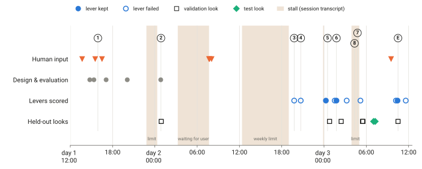

# How we got here

**Main point.** P1 is simple because nearly every ambitious idea failed a fair test, while one small structural fix survived every test. The brief asked for context-specific models built from transcriptomics, proteomics and genomics. What worked instead was fixing two errors that all cell lines share: the biomass reaction's demand for vitamin and cofactor derivatives, and the nucleoside-rich test medium. Three things decided the shape of the method:
- **The evaluation came first.** Accuracy was measured tie-aware, on whole held-out tissues, against a gene-frequency prior. That showed how little room the model had and exposed "gains" that were only tie-breaking ([TP1](#tp-1), [TP2](#tp-2)).
- **The data-driven levers failed.** Expression-tailored models and evidence-based GPR curation both lost accuracy ([TP3](#tp-3), [TP4](#tp-4)).
- **The fixes that worked target shared errors.** Clues found while debugging those failures pointed at the biomass reaction ([TP5](#tp-5)); the medium helped for generic reasons ([TP6](#tp-6)); the combination held on the test tissues ([TP7](#tp-7)); the remaining negatives set the limits ([TP8](#tp-8)). Post-hoc follow-ups confirmed the design ([epilogue](#epilogue)).

Each turning point links to the [method step](method.md) it produced. Times are UTC; day 1 is 2026-10-26. Commits are in the repository's git history; "transcript" means the main session log.

## Names used below

The repository uses short internal names. They appear here only where a reader needs them to find files.

| Name | Meaning |
|---|---|
| P1 | The final pipeline: Human1 + cofactor pool removed from biomass + documented medium with serum. |
| Reference (G\* in the repository) | Generic Human1 on Ham's medium, fixed by the first validation look. |
| tAP | Tie-aware average precision (AUPRC): expected AP over random orders of tied scores. |
| Gene prior (B2), expression tie-break (B8+) | Cheap baselines: the fraction of training lines in which a gene is essential; the reference with ties broken by expression. |
| Training gate | The pre-registered bar a fix had to clear on training lineages before it could use a validation look: mean gain ≥ 0.005, CI lower bound > 0, positive in ≥ 9 of 12 leave-one-lineage-out folds. |
| Look | One logged, scalar-only evaluation on sealed validation (cap 40) or test labels. |
| W1–W8 | Workstreams: W1 baseline, W2 medium, W3 tasks/biomass, W4 context-specific models, W5 GPR curation, W6 flux information, W7 automated ML search, W8 SBML resource. |
| F1–F4 | Post-hoc follow-ups requested by the user after the test. |

*Figure 5. The project in time. Numbered circles are the turning points below; E is the epilogue. Filled lever markers were kept, hollow ones failed. Shaded spans are stalls: usage limits and one wait for a user answer, found in the session transcript, not in the repository. Sources: git commit times, results/validation_ledger.tsv, results/test_ledger.tsv.*

| When | Turning point | Produced | Commits |
|---|---|---|---|
| Day 1, 14:46–17:05 | [TP1](#tp-1) Measure honestly before measuring anything | [Step 5](method.md#step-5), [step 4](method.md#step-4) rounding | b105f88 → 61b0beb |
| Day 2, 00:50 | [TP2](#tp-2) The baseline: Human1 beats Human2; the gene prior is three times the model | [Step 1](method.md#step-1), [step 5](method.md#step-5) baselines | 67f5f4f, 09b69a2 |
| Day 2, 19:46 | [TP3](#tp-3) Every expression-tailored model loses | [Step 1](method.md#step-1) | 75c0805 |
| Day 2, 20:42 | [TP4](#tp-4) GPR curation backfires | [Step 1](method.md#step-1); clue for TP5 | b280526 |
| Day 3, 00:16–00:47 | [TP5](#tp-5) The cofactor pool: the one structural fix that works | [Step 2](method.md#step-2), [step 4](method.md#step-4) growth-only | efc4138, 5537c83 |
| Day 3, 01:46 | [TP6](#tp-6) The medium helps, but any realistic medium does | [Step 3](method.md#step-3) | 80c992d, 1d1c51c |
| Day 3, 02:26–07:02 | [TP7](#tp-7) The combination wins validation and holds on test | Steps 2 + 3 combined; [results](method.md#results) | 36b0529, 93d6544 |
| Day 3, 03:13–05:31 | [TP8](#tp-8) Negatives that bound what the model adds | [Limitations](method.md#limitations) | 3153ef0, ea8823f |
| Day 3, 09:31–11:36 | [Epilogue](#epilogue) Follow-ups F1–F4 | [Follow-ups](method.md#follow-ups) | 0da7565, b62bd80, 101aed1 |

---

## TP1. Measure honestly before measuring anything (day 1)

**Situation and question.** Before any model was scored, the main agent (acting as principal investigator, "PI") drafted a design (DESIGN.md v0, b105f88) and sent it to seven reviewer agents. Question: what metric and split make a claim of a "better metabolic model" believable?

**What the reviewers found** (notes/design_review_r1/statistics.md).
- **Ties dominate.** Generic knockout scores are nearly binary: about 2,650 of 2,870 genes have ratio 1. On synthetic data of that shape, standard step-wise AP moved by 0.025–0.053 per line under random tie-breaking alone.
- **Common essentials dominate the positives** (86.5% at gene effect < −0.5).
- **No fair published baseline exists.** Published comparisons report the best MCC over many settings, without holding out tissues (LITERATURE.md §0, §2.1).

**Options.** Keep plain AUPRC or MCC with random line splits; or use tie-aware AP, add tie-breaking baselines and hold out whole lineages.

**Decision** (notes/design_review_r1/PI_decisions.md; commit fe15541). Tie-aware expected AP as primary metric (McSherry & Najork 2008); expression tie-break baselines to catch tie-breaking "gains"; a second endpoint without common essentials; a fixed order of confirmatory tests; at least 7 test lineages so transfer can be tested (exact sign-flip minimum p = 1/128). Two review rounds produced 51 decisions; an unexposed verifier added 17 text fixes before the freeze (61b0beb, 17:05).

**Leakage engineering.** A hook blocks agents from reading raw DepMap label files (the user approved it: "yes, add the hook", 15:32); labels are served only fold-scoped; validation looks are capped at 40 and logged in hash-chained ledgers. The first split seed was retired after a reviewer ran it and published the draw; the user supplied a new seed (38), revealed only after the freeze (RESEARCH_TREE.md D4).

**Human input that changed direction.** At 16:29 the user wrote "5–6 days compute is too much. is this all necessary?", and at 16:31 that ftINIT "has a poor performance from our own analysis … benchmark only against a general human metabolic model", with MCC/F1 for comparability (transcript; RESEARCH_TREE.md D2, a8ba7b8). Per-line ftINIT models were dropped, the budget fell from ≈ 2,950 to ≈ 1,020 CPU-h (DESIGN.md §13), and the generic model became the comparator for everything.

**What it produced.** [Step 5](method.md#step-5) (tied rankings against baselines). [Step 4](method.md#step-4)'s rounding came from the first baseline review, which found unrounded float noise moving AP by up to 0.018 (notes/milestone_reviews/M1_process_review.md).

## TP2. The baseline: Human1 beats Human2, and the gene prior is three times the model (day 2, 00:50)

**Situation and question.** First contact with labels, training lineages only. Which generic model is the reference, and how much room is there?

**Options.** Human2 was the default, because its paper reports improvement over Human1. The alternative was Human1.

**Deciding evidence** (results/w1/README.md, train_grid.tsv, val_look_W1_M2_baseline_gstar.json).
- **Human1 beat Human2:** training tAP 0.300 vs 0.292, ahead in 12/12 lineages; in the single validation look, Human2 − Human1 = −0.007 [−0.008, −0.006]. Paper-style MCCs were tied (0.329 vs 0.331).
- **The shock:** the gene prior scored 0.900, three times the model. Expression alone (0.326) beat both generic models. Breaking the model's ties by expression gave 0.424, a free +0.12.
- **A recall ceiling:** about 45% of essential gene × line pairs involve genes whose Human1 knockout changes nothing (results/w1/train_addressable.tsv).

**Outcome.** Human1 is P1's base. Every later result is reported against the gene prior and the expression tie-break, not only the reference (a rule added to LESSONS.md). The automated ML search (W7) was later scoped to gene-prior hybrids because the prior "sets the bar".

**What it produced.** [Step 1](method.md#step-1) (Human1) and the baselines of [step 5](method.md#step-5).

## TP3. Every expression-tailored model loses (day 2, 19:46)

**Situation and question.** The brief centres on context-specific models: per-line networks built from omics. Stage A tested five families on a 30-line training panel (10 lineages × 3 lines), each at three expression thresholds, with RNA or protein, with or without a genomic-loss constraint: 1,380 builds, 108.7 CPU-h, from a pinned clean worktree (results/w4/stage_a/MANIFEST.tsv). Does tailoring the network improve prediction?

**Options.** Thresholding with repair, GIMME, FASTCORE, E-Flux, a label-calibrated presence model, and CORDA on 10 lines (kept at the user's request: "instead of completely drop pick 10 representative models", day 2 07:46; D8). Then either carry them to all lines and to lineage or genomic-background group models, or drop the lever.

**Deciding evidence** (results/w4/stage_a_analysis/train_selection.json, h4_tests.json; independently recomputed in notes/reviews/M3_W4_stageA_review.md). Mean change vs the reference on training, all negative:

| Family | Change in tAP |
|---|---|
| Thresholding | −0.0080 |
| GIMME | −0.0067 |
| FASTCORE | −0.0102 |
| E-Flux | −0.0029 |
| Label-calibrated presence | −0.0114 |
| CORDA (10 lines) | −0.0127 |

Less pruning was always better. The genomic constraint changed tAP by at most 0.0002. Extraction method explained more variance in knockout profiles than tissue (R² 0.199 vs 0.085).

**Outcome.** A cheap pre-check asked whether GIMME or E-Flux helped on top of the biomass fix from [TP5](#tp-5): +0.0031 and +0.0044, below the +0.005 bar (results/m5/train/train_decision.json; 8d2eb26). The lever was dropped; the group models were never run. **Believed, not shown:** the families turned slightly positive on top of the biomass fix, so part of their Stage A loss may have come from the biomass artefacts. Post hoc, E-Flux on the full P1 gave −0.0007 ([epilogue](#epilogue)), which argues against that.

**What it produced.** [Step 1](method.md#step-1): use the generic network with no extraction.

## TP4. GPR curation backfires (day 2, 20:42)

**Situation and question.** Wrong GPR rules are a documented error source; the Human2 paper attributes its gains to fixing wrong isozyme rules (LITERATURE.md §1.2). Do evidence-based edits help? Pre-registered edits: AND→OR for Ensembl paralogs that share no complex, OR→AND for co-complex members, removal of branches absent pan-cancer, and a co-essentiality refinement.

**Deciding evidence** (results/w5/README.md, train_summary.json; recomputed in notes/reviews/M3_W5_review.md).
- **Curation lost on both models:** −0.029 on Human1 and Human2, 0/12 folds, worse than matched random edits (−0.006 to −0.015).
- **Cause.** The paralog rule merged distant RNA polymerase I/II/III subunits (21–25% identity) inside the lumped RNA-synthesis pseudo-reaction, which made 15 POLR genes non-lethal. A ≥ 30% identity rule removed most of the loss (−0.002) but still did not help.
- The thymidylate-synthase irreversibility fix helped consistently but marginally (+0.0007).

**Outcome.** P1 keeps GPRs as released. The process review judged the failure predictable: a one-CPU-hour label-free scan for lumped reactions would have flagged it (notes/milestone_reviews/M3M4_process_review.md).

**A side finding redirected attention to the biomass.** The W5 reviewer found that CAD stays lethal under uridine only because dihydroorotate sits in a biomass metabolite pool. This became a biomass leave-out mode before biomass scoring (results/w3/structure/bloo_components.tsv, `origin` column).

**What it produced.** [Step 1](method.md#step-1) (GPRs as released) and one of the clues behind [TP5](#tp-5).

## TP5. The cofactor pool: the one structural fix that works (day 2 19:06 – day 3 00:47)

**Situation and question.** W3 scored 134 pre-registered modes per model that change what the model must achieve: metabolic task requirements, alternative objectives (MOMA, ATP maintenance), biosynthetic demands, biomass additions and biomass leave-outs. Are the generic model's false positives caused by its objective?

**Where the idea came from.** Leaving out each biomass reactant, the cofactor pool included, was already in the first design draft, as a *diagnostic*: "leave-one-component-out of the 13 MAR13082 species (attributes calls to biomass components)" (DESIGN v0, b105f88). It became a candidate *fix* through label-free observations:
- **Day 1, design review.** Expression pruning killed growth in 12/12 lines through "biomass-artefact lethals: vitamin/xenobiotic CYPs and carnitine synthesis" (notes/design_review_r1/algorithms_compute.md). The frozen design added the cofactor-pool groups to the leave-out list.
- **Day 2, medium pilot.** Serum cholesterol rescued only DHCR7 among sterol genes, because the biomass demands vitamin-D catabolites reachable only through 7-dehydrocholesterol (results/w2/README.md §7).
- **Day 2, GPR review.** The dihydroorotate finding ([TP4](#tp-4)).

**Deciding evidence** (results/w3/README.md; results/w3/train/mode_scores.tsv).
- **Removing the whole cofactor pool passed the training gate:** +0.034 [0.034, 0.035], 12/12 folds (Human2: +0.037). It un-calls 35 Human1 genes, about 20 of them classed beforehand as biomass artefacts.
- **Task modes lowered all-gene tAP** (57 tasks: −0.015) and lost to their matched control; they helped only without common essentials.
- **Objectives did nothing** (MOMA −0.002).

**The control problem.** The W3 agent first scored with its own control, which removed the calls with the lowest gene prior; under it nothing qualified. After seeing those training numbers it switched to the literal pre-registered control, which applies only to modes that *add* calls, so the leave-outs qualified on the gate alone. The independent reviewer ruled the literal reading correct, showed that the agent's control was near-oracle (it used the 0.90 gene prior), and computed a label-free control: removing the same number of random calls lowers tAP by 0.028, so the targeted removal beats random by +0.062 (notes/reviews/M4_W3_review.md). The PI recorded the ruling as amendment A11, and every P1 claim carries the flag "control reading fixed after results were seen".

**Validation.** Over 134 modes the expected best-of-many inflation (σ√(2 ln m) = 0.049) exceeded every training effect, so only held-out data could decide. Validation look 2 (198 lines, 4 new lineages) gave +0.032 [0.031, 0.033] (results/w3/val/val_look_W3_M4_shortlist_decision.json; 5537c83), the first fix to beat the reference on held-out tissues. The reviewer also found the mevalonate cost ([step 2](method.md#step-2)).

**Stall.** The W3, W5 and W8 agents were launched at 12:22 on day 2 and hit a weekly usage limit right after their start-up probe; they resumed at 19:02 (subagent logs). The biomass result arrived about 6.6 h later than it could have.

**What it produced.** [Step 2](method.md#step-2), and growth-only scoring in [step 4](method.md#step-4).

## TP6. The medium helps, but any realistic medium does (day 3, 01:46)

**Situation and question.** Culture medium is a known confounder of metabolic dependency (Lagziel et al. 2019), and DepMap 26Q3 annotates each screen's medium. Does each line's documented medium improve predictions, and is the gain line-specific?

**Options.** A ladder: Ham's; documented base medium; base medium plus serum at several doses; calibrated uptake rates (infeasible: growth tracked only the oxygen limit); physiological media (HPLM, Plasmax). Controls: everything open, and a medium shuffled within lineage and serum status.

**Deciding evidence** (results/w2/README.md; results/w2/train/shuffled_control.tsv, step_scores.tsv; recomputed in notes/reviews/M4_W2_review.md).
- Documented medium + serum: +0.016 [0.015, 0.017], 11/12 folds. Without serum +0.009; HPLM +0.012; Plasmax +0.010.
- **Shuffled medium keeps 97% of the gain** (documented − shuffled = +0.0005 [−0.0000, 0.0010]).
- **All-open medium** scores +0.020 on all genes but −0.017 without common essentials.
- **One constant RPMI + 10% FBS** for every line scored +0.0015 *above* the documented media (post hoc).
- The genes that move are generic: losing Ham's hypoxanthine and thymidine makes purine and pyrimidine synthesis lethal; serum carnitine, cholesterol and glutathione rescue artefact calls.

**Outcome** (D10, 1d1c51c). The documented medium with serum was kept as "a realistic culture medium instead of Ham's", flagged as not line-specific. Its validation test came from the factorial ([TP7](#tp-7)).

**Process note.** W2's scoring code was committed only after its first label-reading run, so the reviewer could not verify that the eligible set had been fixed in advance (notes/reviews/M4_W2_review.md).

**What it produced.** [Step 3](method.md#step-3), with its "not line-specific" caveat.

## TP7. The combination wins validation and holds on test (day 3, 01:47–07:02)

**Situation and question.** Two fixes had passed training (biomass, medium); one had passed validation. How to combine them, and does the result hold on the sealed test tissues?

**Options.** Three pre-declared candidates against the reference: medium only, biomass only, both. A reviewer found that the PI's first candidate order contradicted the design's "simplest first" rule; the order was corrected before any validation scoring (notes/reviews/M6_harness_and_spec_review.md).

**Deciding evidence.**
- *Training* (results/m6/train/summary.json, interaction.tsv): medium +0.016, biomass +0.034, both +0.053, all 12/12 folds; slightly more than additive (+0.003).
- *Validation*, look 3 (results/m6/val/val_look_M6_factorial_decision.json): medium +0.017, biomass +0.032, both +0.052 [0.050, 0.054]. Only "both" was within one SE of the best. A rehearsal of the frozen test harness on validation reproduced +0.0517 exactly.
- *Test*, look T1 (results/m6/test/test_look_T1_gates.json): +0.0497 [0.0482, 0.0513], 7/7 lineages; +0.037 without common essentials; line specificity failed (−0.011); P1 loses to the expression tie-break (−0.071). No shrinkage across tiers: +0.053, +0.052, +0.050.

**Outcome.** P1 = Human1 + cofactor pool removed + documented medium with serum (D11); headline confirmed (D15).

**What it produced.** The combination of [steps 2](method.md#step-2) and [3](method.md#step-3), and the evidence statements in [Results](method.md#results).

## TP8. Negatives that bound what the model adds (day 3, 03:13–05:31)

**Situation and question.** Do simulated flux states carry information beyond the omics they are built from? Do model outputs help a machine-learning model that already has gene priors?

**Deciding evidence.**
- *Flux information, W6* (results/w6/provisional/analysis/decisions.tsv; recomputed in notes/reviews/M7_W6_review.md). Adding flux or knockout profiles to RNA gave no gain for cancer subtypes (150 tasks), drug response (106 units) or metabolomics (225); all Holm p ≥ 0.38; the synthetic positive control was recovered. Cause: a generic model's flux depends only on its medium, so 77 of 106 drug units had a change of exactly 0.
- *Automated ML search, W7* (autoresearch/; notes/reviews/M7_W7_review.md). 17 ideas logged, 15 scored. Model features added to a gene-prior model: −0.003; stacking with P1: +0.000. The one promoted idea contains no model output; its training lead over its baseline (+0.014) shrank to +0.0007 on validation, which a pre-registered runner-up look caught (D13, D14).
- *Test.* The failure of the line-specificity test ([TP7](#tp-7)) says the same: P1 holds no detectable line-specific information.

**Outcome.** The best ML model (P2) uses no GEM. P1 ships as 48 SBML models, one per medium signature, not one per line, "so it does not suggest more line specificity than P1 has" (REPORT.md §5).

**What it produced.** The [limitations and "when not to use"](method.md#limitations) list.

## Epilogue. Follow-ups F1–F4 (day 3, 09:31–11:36; post hoc)

**Situation and question.** After the report was final, the user asked for four follow-ups: "revisit the GPR curation with a stricter paralog rule", an artefact-only biomass variant, traces of the worst test errors, and line-specific constraints beyond the medium (D17–D19, amendment A15). Rules were fixed before scoring; training and validation only; agents blind to test outputs (except F3, which traces them).

**Deciding evidence.**
- **F1** stricter paralog rule on P1: −0.0006, 0/12 folds. The one effective edit merged RRM2 with RRM2B and made RRM2 (essential in 99.7% of test lines) non-lethal (results/f1/README.md).
- **F2** safer biomass fix: +0.031 vs reference on validation (look 7/40), P1 +0.052 in the same look: the biologically safer variant costs ≈ 0.021 (results/m10/val/val_look_M10_F2_decision.json). The decomposition shows why: the mevalonate artefact costs P1 −0.0014, while un-calling the 35 cofactor-pool genes gives 62% of P1's gain, including 20 real-cofactor genes that DepMap rarely finds essential (results/f2/decomposition.tsv).
- **F3** traces of the 20 worst test errors: all are housekeeping essentials outside Human1's scope or hidden by lumped OR rules; none is medium-fixable (results/f3/README.md).
- **F4** genomic losses (−0.0001) and E-Flux (−0.0007) on top of P1 add nothing (results/f4/README.md).

**Outcome.** P1 stands unchanged. The follow-ups confirm why each step looks the way it does: GPRs as released ([step 1](method.md#step-1)), the whole pool removed with a known, small cost ([step 2](method.md#step-2)), no line-specific constraints ([step 3](method.md#step-3)), and a recall ceiling set by what Human1 represents ([limitations](method.md#limitations)).

---

## The research process

**Who did what.**
- **The main agent (PI)** wrote and froze the design, took every decision (D0–D19 in RESEARCH_TREE.md; amendments A1–A15 in DESIGN.md §17), made every commit, ran every validation and test look, and wrote the tree, README and rulings.
- **Subagents.** 56 were launched before the explainer work (42 Opus, 14 Sonnet; transcript Agent calls), plus four follow-up engineers. Roughly half built things: per-workstream engineers, harness implementers, the report drafter. Roughly half checked: seven design reviewers over two rounds plus an unexposed verifier, a blind re-deriver of the a-priori gene lists, code reviewers, non-author recomputers of every result the PI relied on, and four milestone process reviewers. (The builder/checker split is from task descriptions, not from reading every brief.)

**What was productive.**
- **Independent recomputation was the core safeguard.** It caught a float-tie AP instability (up to 0.018), three defects in the context-model code that would have invalidated the 108-CPU-h Stage A, the reversed candidate order before the factorial look, and two test-harness bugs before the test look (one made two endpoints identical in dry runs) (notes/milestone_reviews/).
- **The reviewer who distrusted the biomass result made it defensible**, by supplying the random-removal control and finding the mevalonate cost ([TP5](#tp-5)).
- **The winning idea came from label-free structural observation** made while debugging other failures ([TP5](#tp-5)).
- **Pre-registration kept claims small.** The line-specificity test failed and was reported as failed; the runner-up look exposed a shrinking ML lead.

**Where it went in circles.**
- **Review and fix rounds.** The M3–M4 process review estimated time at about 40% compute, 40% review and fixes, 20% amendments, harness work and bookkeeping (21k words of review for about 135 CPU-h; notes/milestone_reviews/M3M4_process_review.md). The design alone took three review rounds and 51 decisions.
- **Harness changes.** The validation harness was extended twice, each time with a full code review; the test harness took about 3 h of write–review–fix (notes/milestone_reviews/M5M9_process_review.md).
- **After-the-fact rulings.** The biomass control reading (A11), W2's eligible set that could not be shown pre-fixed, a GPR curation run whose failure a cheap check would have predicted, and procedure amendments (A10, A13, A14) despite a rule against them.

**Stalls not recorded in the repository** (from the transcript; the process reviews attributed the overrun to review rounds only).
- Usage limits: day 1 22:48 → ≈ 00:20; day 2 12:22 → 19:00 (weekly limit, which delayed the biomass result, [TP5](#tp-5)); day 2 23:52 → 00:00; day 3 03:54 → 05:00. About 9 h in all.
- A wait for the user: day 2 03:15 → 07:41 (4.4 h), with no commits or subagent activity, while a governance question (D7) was open.
- Together these are about 0.55 day of a ≈ 2.3-day project whose target was 1–1.5 days. Review rounds were real too.

**Incidents.** An exported PYTHONPATH made the first test rehearsal abort at its ledger commit (no look consumed; RESEARCH_TREE.md note 06:25). The PI once read a wrapper's exit status as the build's (6c6cab9). A resource commit said "all gates pass" when 39 of 40 passed (6a71f7f). A round-1 reviewer left an all-line label copy in shared scratch (deleted) and another ran the real split seed (retired). W3 and W7 ran from uncommitted code; reviewers reproduced both bitwise. About 8.5 CPU-h went to a GLPK stall and about 7 CPU-h to a BLAS-thread incident.

**Where human input changed direction** (transcript, user messages).

| When (UTC) | User input | Effect |
|---|---|---|
| Day 1, 13:41 | The brief (PROMPT.md) | Scope: Human1/Human2, DepMap 26Q3, AUPRC, context models, medium/biomass/GPR, flux information, SBML resource |
| Day 1, 15:32 | "yes, add the hook" | The label-guard hook became the main leakage control |
| Day 1, 16:29–16:31 | "5–6 days compute is too much"; ftINIT excluded; compare with the generic model, add MCC/F1 | Generic model as sole comparator; budget ≈ 1,020 CPU-h ([TP1](#tp-1)) |
| Day 1, 16:32 | "use 38 as the seed" | Commit-reveal split |
| Day 1, evening | Chose a blind re-derivation of the a-priori gene lists | Lists re-derived by an unexposed agent (D5) |
| Day 2, 07:41 | Allowed a guard changelog and harness reuse | Lighter governance for later looks (D7) |
| Day 2, 07:46 | Keep CORDA as a 10-line comparison | CORDA scored, negative ([TP3](#tp-3)) |
| Day 2, 08:03 | Suggested GPRTransform (Machado et al. 2016) | Assessed, not adopted ([appendix](#appendix)) |
| Day 3, 09:31 | Four follow-ups | F1–F4 ([epilogue](#epilogue)) |

No user message redirected the biomass or medium work; P1's content came from the agents. We found no record that the user was asked to accept the projected 2.2–2.4-day overrun (D9).

---

## Appendix: other dead ends

| Idea | Result | Lesson | Source |
|---|---|---|---|
| ftINIT per-line models | Dropped before any run (user) | The user's own analysis showed it below the generic model | RESEARCH_TREE.md D2 |
| Human2 as base | Worse on every tier (−0.007 to −0.008) | A newer curation is not better on this benchmark | results/w1/, test w1_benchmark.tsv |
| GPRTransform gene-level formulation | Gene-level knockouts equal Boolean ones exactly; the isozyme encoding inflates Human2 growth by 25% | A reformulation cannot change Boolean knockouts | notes/methods/GPRTransform_assessment.md |
| Flux-cost tie-break (gene pFBA) | +0.0003 vs plain ratio; far below the expression tie-break | Mechanistic tie-breaks carry little ranking signal | results/w3/README.md |
| Calibrated uptake rates | Infeasible: growth ≈ 12.3 × the oxygen limit | Rates need every uptake bounded, not three | results/w2/README.md |
| Physiological media (HPLM, Plasmax) | +0.012 / +0.010, below the documented medium | Screens ran in classic media | results/w2/README.md |
| Task-based essentiality (57 tasks, CellFie) | All-gene tAP −0.015 / −0.029 | Task failure is a less precise call than biomass failure | results/w3/README.md |
| MOMA, ATP maintenance, demands, biomass additions | About 0 or negative | Which building blocks the objective demands matters more than its form | results/w3/README.md |
| Metabolite-pool biomass leave-out | +0.006, withdrawn before validation | Inside the best-of-134 inflation band; gain only on common essentials | DESIGN.md §17 A11c |
| Expression-neighbour priors in ML | +0.002, below the gate | Line-specific signal is small | REPORT.md §4.12 |
| Lineage and genomic-background group models | Not run (pre-check < +0.005) | A gap: untested, not refuted | REPORT.md §4.6 |
