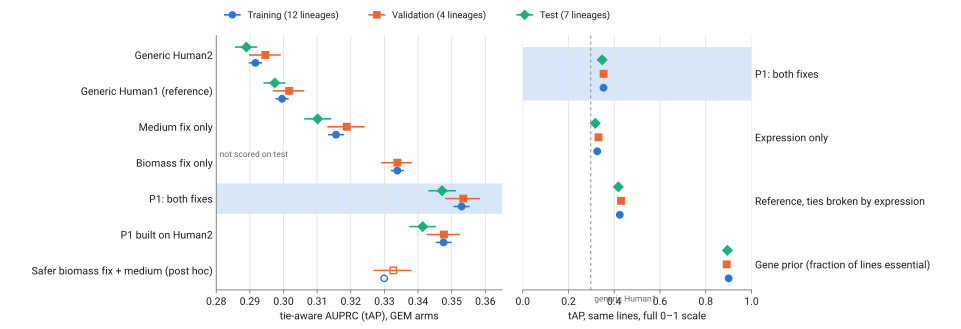
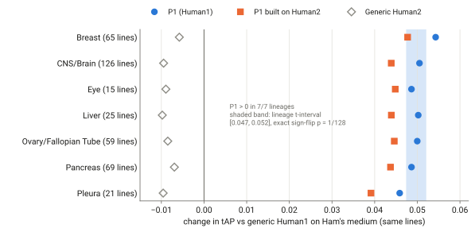
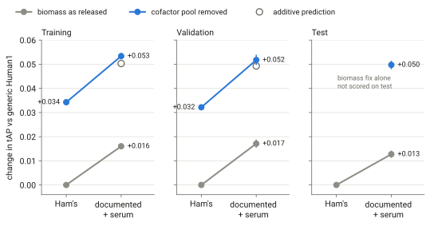
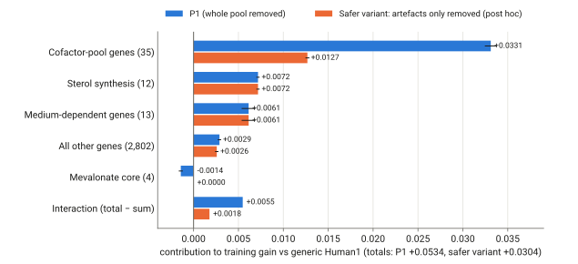

# The method: two structural fixes to Human1

**Main point.** The method takes the published human metabolic model Human1, changes two things in it, and uses it to predict which metabolic genes a cancer cell line needs to grow. The two changes are: the model no longer has to make a small pool of vitamin and cofactor derivatives as part of "growth", and it may only take up what the line's culture medium and serum supply. On seven cancer types that were held out from all development, this raised the accuracy of the model's essential-gene ranking from 0.297 to 0.347 (tie-aware AUPRC, +0.050, positive in 7 of 7 tissues). The gain comes from removing errors that every cell line shares. The method does not capture line-specific biology, and a simple gene-frequency prior that uses no model at all remains far more accurate (0.895).

In the repository this pipeline is called **P1**; this page uses that name from here on.

Every number below cites the committed file it comes from (paths are relative to the repository root, `/data/tmpA/nextgem`). **Shown** means measured in a committed result; **believed** means our interpretation; **unverified** marks claims we could not check against code or results.

Contents: [one sentence](#one-sentence) · [terms](#terms) · [how it differs](#how-it-differs) · [overview](#overview) · [steps 1–5](#step-1) · [worked example](#worked-example) · [pseudocode](#pseudocode) · [results](#results) · [follow-ups](#follow-ups) · [limitations](#limitations) · [credits](#credits)

<a id="one-sentence"></a>
## In one sentence

**Problem:** predict which metabolic genes a cancer cell line depends on. **Input:** the line's documented culture medium (base medium plus serum). **Output:** for each of 2,866 metabolic genes, a score e between 0 and 1, the fraction of simulated growth lost when the gene is knocked out in the edited Human1 model, which is read as a ranking of likely essential genes for that line.

<a id="terms"></a>
## Terms

- **Genome-scale metabolic model (GEM).** A network of the known metabolic reactions of human cells, with each reaction linked to the genes that encode its enzymes by a **gene–protein–reaction (GPR) rule**. A GPR rule is Boolean: "subunit A AND subunit B" for a complex, "isozyme A OR isozyme B" for alternatives.
- **Human1** is Human-GEM v1.19.0 (2,887 genes; Robinson et al. 2020). **Human2** is Human-GEM v2.1.1 (2,870 genes; Luo et al. 2026), a later, more heavily curated release.
- **Flux balance analysis (FBA).** Finds reaction rates (fluxes) that maximise flux through the **biomass reaction** under limits on what the cell may take up from the **medium**. The biomass reaction is a pseudo-reaction that consumes the building blocks of a new cell (protein, lipid, DNA, RNA, cofactors) in fixed proportions; its flux is the model's "growth". Growth values here are in arbitrary units (a.u.), because uptake limits mark availability, not measured rates.
- **Knockout.** Removing a gene closes every reaction whose GPR rule becomes false. A gene is **called lethal** when knockout growth falls below 1% of normal growth (e ≥ 0.99).
- **DepMap** is the Cancer Dependency Map: genome-wide CRISPR knockout screens in about 1,100 cancer cell lines. The label used here is DepMap's **dependency probability > 0.5** (release 26Q3, Chronos gene effects). A gene is **essential** in a line when the label is positive.
- **Lineage.** The tissue of origin of a cell line (lung, breast, CNS/brain…). Lineages were the unit of hold-out.
- **Common essentials.** Genes essential in nearly every line. They make up most positives (86.5% at gene effect < −0.5; notes/design_review_r1/statistics.md).
- **AUPRC / AP.** Area under the precision–recall curve, computed as average precision over a ranked gene list. Higher is better; a random ranking scores about the fraction of essential genes (about 0.12 here).
- **Tie-aware AP (tAP).** The expected AP when tied scores are put in random order (McSherry & Najork 2008). FBA scores are mostly tied, so ordinary AP would depend on an arbitrary tie order.
- **Training, validation and test tiers.** The 1,361 screened lines were split once by lineage: 12 training lineages (686 scored lines), 4 validation lineages (198) and 7 test lineages (380) (results/splits/split_meta.json). Development used training labels only. Validation and test labels were sealed and could be read only through a logged, capped evaluation run (a **look**).
- **Reference model.** Generic Human1 on Ham's medium, the standard test medium of the Human-GEM project (its "growth on Ham's" task, 44 inputs). It was fixed as the comparator by the first validation look, before any fix was scored.

<a id="how-it-differs"></a>
## How it differs from standard approaches, and why that matters

**The standard approaches.**
- **Generic-model knockouts.** The Human1 and Human2 papers knock out genes in the generic model on a default medium and report Matthews correlation (MCC) against a binarised CRISPR label. Published MCCs are about 0.25–0.45, usually the best of many settings, without whole-tissue hold-out (LITERATURE.md §0, §2.1).
- **Context-specific models.** tINIT/ftINIT, iMAT, GIMME, FASTCORE, E-Flux and CORDA prune or down-weight reactions per cell line from expression data, so that each line's model reflects its own biology (LITERATURE.md §3.1).

**What P1 does instead.** P1 keeps the network and its GPR rules as released and uses no omics. It changes what the model is asked to achieve (the biomass reaction) and what it may take up (the medium).

**Why that matters.**
1. **The largest fixable error was in the objective, not in missing context.** Removing the cofactor pool from biomass gained +0.032 on held-out validation lineages (shown: results/w3/val/val_look_W3_M4_shortlist_decision.json). Every expression-based family lowered accuracy on training lineages, by 0.003 to 0.013 (shown: results/w4/stage_a_analysis/train_selection.json), and extraction method explained more of the variance in knockout profiles than tissue did (R² 0.199 vs 0.085; results/w4/stage_a_analysis/h4_tests.json), as Opdam et al. 2017 and Richelle et al. 2019 found on smaller panels.
2. **The evaluation rewards real ranking.** About 94% of P1's gene scores tie at "no effect", so the headline uses tie-aware AP, on lineages never used for development, against cheap baselines that expose free gains ([step 5](#step-5)). Many published comparisons do neither.
3. **The gain transferred without shrinking.** P1 has no fitted parameters. Its gain was +0.053 on training, +0.052 on validation and +0.050 on test (results/m6/train/summary.json; results/m6/val/val_look_M6_factorial_decision.json; results/m6/test/test_look_T1_gates.json).

<a id="overview"></a>
## Overview

```
INPUT                      STAGES                                                         OUTPUT
Human1 v1.19.0 SBML ─┐
                     ├─ 1 generic network, GPRs as released ............ (no omics)
                     ├─ 2 remove cofactor pool from biomass MAR13082 ... (same for every line)
line's medium text ──┼─ 3 uptake = base medium + serum + micronutrient floor (classic RPMI + 10% FBS if unknown)
                     └─ 4 knock out each gene, e = 1 − KO growth / normal growth  ──►  e per gene per line
                        5 read e as a ranking with ties; compare with gene-prior and expression baselines
```



*Figure 1. Lineage-equal tie-aware AUPRC with 95% CIs (line bootstrap) on the three tiers. Left: GEM pipelines on a narrow scale. Right: P1 against cheap baselines on the full 0–1 scale; the dashed line is the generic reference on test. Sources: results/m6/train/cells.tsv, results/w1/train_grid.tsv, results/m6/val/val_look_M6_factorial.tsv, results/w1/val_look_W1_M2_baseline.tsv, results/m10/val/val_look_M10_F2.tsv, results/m6/test/unsealed/T1/w1_benchmark.tsv.*

<a id="step-1"></a>
## Step 1. Start from the generic Human1 network, unchanged

**What.** Load Human1 (Human-GEM v1.19.0) as released: no expression-based pruning, no GPR edits.

**Why.**
- **Human1, not Human2.** Human1 beat Human2 in all 12 training lineages (tAP 0.300 vs 0.292; results/w1/train_grid.tsv), on validation (−0.007 for Human2; results/w1/val_look_W1_M2_baseline_gstar.json) and as P1's base on test (0.347 vs 0.341; results/m6/test/unsealed/T1/w1_benchmark.tsv). The Human2 paper reports the opposite under its own protocol (MCC, ftINIT models), which this project did not reproduce.
- **No context-specific pruning.** All five expression-based families and CORDA lost to the plain model on training lineages, and less pruning was always better (results/w4/stage_a_analysis/README.md). Added on top of the other P1 fixes, the best two still added less than +0.005 (results/m5/train/train_decision.json), and E-Flux on the full P1 added −0.0007 (post hoc; results/f4/README.md).
- **No GPR curation.** Evidence-based curation lost 0.029 (results/w5/train_summary.json). A stricter post-hoc rule also lost 0.0006 on top of P1 (results/f1/README.md).

**What goes wrong without it.** Expression pruning removes correct generic calls faster than it adds line-specific ones (believed; consistent with "less pruning is always better"). Paralog merges in GPR rules can turn true essential genes into "viable" ones: merging RNA polymerase subunits made 15 POLR genes non-lethal; merging RRM2 with RRM2B made RRM2, essential in 99.7% of test lines, non-lethal (results/f1/README.md; results/m6/test/unsealed/T1/per_gene.tsv).

Shaped by [turning point 2](journey.md#tp-2), [3](journey.md#tp-3), [4](journey.md#tp-4) and the [follow-ups](journey.md#epilogue).

<a id="step-2"></a>
## Step 2. Remove the cofactor pool from the biomass reaction

**What.** Human1's biomass reaction (`MAR13082`) has 9 reactants. One of them is a pseudo-metabolite, `cofactor_pool_biomass` (`MAM10012c`, coefficient 0.0012), assembled by reaction `MAR10065` from 38 species: 20 retinoid catabolites, 4 vitamin-D catabolites, 2 tocopherol catabolites, carnitine, heme, ubiquinol, lipoate, cobamide and seven B-vitamin-type cofactors (biotin, FADH2, pyridoxal phosphate, riboflavin, BH4, THF, thiamin-PP) (results/w3/structure/structure_summary.json; recounted by the worked example). P1 deletes that one reactant (`nextgem.w3.Variant(kind="remove", mets=["MAM10012c"])`; spec in results/w3/structure/variants_human1.json). Normal growth barely changes: 65.573 → 65.577 a.u. on Ham's (results/m6/sweeps/catalog.tsv).

**Why.**
- With the pool in place, any gene needed to *make* one of the 38 species is lethal in the model, however small the coefficient. Several species are degradation products (retinoid and vitamin-D catabolites) that a dividing cell has no reason to make. On Ham's medium, removing the pool un-calls 35 Human1 genes (recomputed in the [worked example](#worked-example)).
- **Shown:** those 35 genes are rarely essential in DepMap. Averaged over the 380 test lines, they are essential in 14% of lines (median 1.6%), against 73.5% for the genes P1 still calls lethal (../data/gene_groups.tsv in this explainer, from results/m6/test/unsealed/T1/per_gene.tsv).
- This holds for both kinds of un-called genes. The 15 catabolite and carnitine "artefact" genes average 13%; the 20 genes that make real cofactors (heme, CoQ, BH4, B6, B1, B2) average 15%. Calling a gene lethal in every line pays off only if it is essential in most lines, so un-calling both groups improves the ranking (believed; the decomposition below measures it).
- The edit was one of the pre-registered "biomass leave-one-out" modes (DESIGN.md §9). It became a candidate fix after three label-free clues pointed at the biomass ([turning point 5](journey.md#tp-5)).

**What goes wrong without it.** The medium fix alone gains +0.013 on test against +0.050 for P1 (results/m6/test/unsealed/T1/attribution.tsv). Removing the same number of calls at random lowers training tAP by 0.028; the targeted removal beats random removal by +0.062 (notes/reviews/M4_W3_review.md §2), so the gain depends on *which* calls go.

**Where the gain comes from (post hoc, training).** Un-calling the 35 cofactor-pool genes contributes +0.033 of P1's +0.053 (62%). The mevalonate side effect below costs −0.0014 (results/f2/decomposition.tsv; [Figure 4](#follow-ups)).

**Known cost.** The pool also holds ubiquinol, the only use of the mevalonate pathway other than sterols. Once it is removed and serum supplies cholesterol (step 3), the core mevalonate genes HMGCR, MVK, PMVK and MVD become non-lethal (knockout keeps 98.5% of growth) on all 19 serum media (results/m6/scores/w3_mev.tsv). In DepMap they are essential in 43–90% of test lines (results/m6/test/unsealed/T1/per_gene.tsv). This is a known positive control that P1 gets wrong. A safer variant that removes only the catabolites and carnitine fixes it but loses 0.021 on validation ([follow-ups](#follow-ups)).

Shaped by [turning point 5](journey.md#tp-5), [turning point 7](journey.md#tp-7) and the [follow-ups](journey.md#epilogue).

<a id="step-3"></a>
## Step 3. Let the model take up only what the medium and serum supply

**What.** Uptake limits are set from the line's documented base medium (RPMI-1640, DMEM, DMEM:F12, IMDM, with listed supplements) from DepMap's screen and model annotations (results/w2/media_library/line_media.tsv).
- Every listed component may be taken up (limit 1,000).
- A fixed micronutrient floor supplies vitamins the biomass needs but the formulation omits.
- A serum model adds palmitate, stearate, oleate, cholesterol, carnitine and ethanolamine at the model's own requirement, plus iron, zinc and copper.
- Cysteine stays closed unless 2-mercaptoethanol is present.
- A line with no usable annotation gets classic RPMI-1640 + 10% FBS.

Code: `nextgem.media.uptake_bounds(model, "M2", medium, pc, f=1.0)` (src/nextgem/media.py:727); bounds rebuilt by `nextgem.w2_engine.build_sweeps` (src/nextgem/w2_engine.py:50). The media library was extracted blind by two agents (312/313 components agreed; results/w2/README.md).

**Why.**
- Ham's medium contains hypoxanthine and thymidine, which let the model bypass de novo purine and pyrimidine synthesis. Moving Human1 to classic RPMI + serum makes 8 genes lethal (ATIC, GART, PAICS, PFAS, PPAT, TYMS, DHODH, UMPS); these are essential in 44% of test lines on average (../data/gene_groups.tsv).
- Serum carnitine, cholesterol and the glutathione in the medium rescue 13 genes that are essential in only 16% of test lines on average (BBOX1, TMLHE, ALDH9A1, SHMT2, SEC11A/C, SPCS1/2/3, DHCR7, GCLC, GCLM, GSS).
- Medium-dependent metabolic essentiality is documented in DepMap and in physiological-medium screens (Lagziel et al. 2019; Rossiter et al. 2021).

**What goes wrong without it.** Without the medium step, the biomass fix alone reaches +0.032 on validation, against +0.052 with both (results/m6/val/val_look_M6_factorial_decision.json). Without serum, the medium's training gain falls from +0.016 to +0.009 (results/w2/README.md).

**What this step is not.** It is not line-specific (shown):
- A medium shuffled between lines of the same lineage and serum status keeps 97% of the gain (documented − shuffled = +0.0005 [−0.0000, 0.0010]; results/w2/train/shuffled_control.tsv).
- One constant RPMI + 10% FBS for every line scored slightly *higher* than the documented media (+0.0015, post hoc; results/w2/README.md).
- Of the 1,361 screened lines, 1,050 share one classic-RPMI model, and 485 receive classic RPMI by default because their medium was missing, unmappable or imputed (results/m6/scores/line_assignment.tsv).

In practice step 3 means "a realistic culture medium with serum instead of Ham's".

Shaped by [turning point 6](journey.md#tp-6) and [turning point 7](journey.md#tp-7).

<a id="step-4"></a>
## Step 4. Knock out every gene and score the growth lost

**What.** Maximise biomass for the unperturbed model. For each gene, close the reactions its loss disables (cobra's `knock_out`), re-optimise, and record ratio = clip(round(KO growth / normal growth, 6), 0, 1). The score is e = 1 − ratio. Two exact shortcuts skip most linear programs: a gene whose closed reactions carry no flux in the unperturbed solution cannot change growth, and genes that close the same reaction set share one solve. Code: `nextgem.w3.ko_sweep` (src/nextgem/w3.py:445), driven by scripts/m6_sweeps.py with GLPK and a 300 s limit per LP. One sweep needs 170–215 LPs and 30–45 CPU-s (worked example).

**Why.**
- Loss of biomass production is the standard FBA proxy for loss of proliferation.
- Growth-only scoring, rather than the 57 "essential metabolic tasks" of the Human1 paper: task-based calls lowered all-gene tAP (−0.015 on training; results/w3/README.md), and on test 30 of 57 single tasks lowered tAP when added to P1 (results/m6/test/unsealed/T1/per_task.tsv).
- Rounding matters. Unrounded ratios differ by floating-point noise between identical runs, and that noise alone moved AP by up to 0.018 (notes/milestone_reviews/M1_process_review.md).

**What the output looks like.** Nearly binary. For NCI-H460, P1 calls 106 of 2,866 scored genes lethal, 64 partial, and 2,696 (94%) tie at e = 0; only 17 distinct values occur (worked example).

<a id="step-5"></a>
## Step 5. Read the scores as a ranking with ties, against strong baselines

**What.** Per line, rank genes by e and score the ranking with tie-aware AP (`nextgem.metrics.tap`, src/nextgem/metrics.py:123). Average over lines with equal weight per lineage (`lineage_equal_mean`, :526). Always report it next to three cheap baselines:
- **gene prior:** the fraction of training lines in which the gene is essential (uses labels, no model);
- **expression only:** the gene's expression in the line;
- **reference with an expression tie-break:** generic Human1 scores with ties broken by expression.

**Why.**
- With 94% ties, ordinary AP depends on the tie order. On synthetic data shaped like generic FBA output, random tie-breaking alone moved AP by 0.025–0.053 per line (notes/design_review_r1/statistics.md).
- Breaking the reference's ties by expression is worth +0.12 on its own (0.424 vs 0.300 on training; results/w1/train_grid.tsv), more than both P1 fixes together.
- The gene prior reaches about 0.90 because DepMap essentiality is dominated by gene identity.

**What goes wrong without it.** A GEM "improvement" can be tie-breaking or gene identity under another name. On test, P1 (0.347) beats the reference (0.297) but loses to the reference with an expression tie-break (0.418) and closes only 8.3% of the gap to the gene prior (0.895) (results/m6/test/test_look_T1_gates.json; results/m6/test/unsealed/T1/w1_benchmark.tsv).

Shaped by [turning point 1](journey.md#tp-1) and [turning point 2](journey.md#tp-2).

<a id="worked-example"></a>
## Worked example: NCI-H460 traced through every step

**The line.** NCI-H460 (DepMap `ACH-000463`), a large-cell lung carcinoma line in the training tier. DepMap documents its screen medium as "RPMI + 10% FBS". Its P1 model is shared with 1,049 other screened lines that also map to classic RPMI + serum.

**How it was produced.** `scripts/explainer_worked_example.py` (in the repository, uncommitted) re-runs the four knockout sweeps with the project's own engine and checks every score against the committed P1 score table: maximum absolute difference 0 at every step. Total cost 2.6 CPU-min. Outputs: ../data/worked_example.json, ../data/worked_example_panel.tsv, ../data/worked_example_steps.tsv. No label file is read. The line's accuracy comes from the committed per-line table (results/m6/train/per_line.tsv; the reference value equals results/w1/train_per_line.tsv). Instead of the line's own labels, each gene's column "test lines essential" gives the fraction of the 380 *test* lines (other tissues) in which DepMap finds it essential (results/m6/test/unsealed/T1/per_gene.tsv).

**Step by step.**

| | Step 0: reference (Ham's) | Step 1: + pool removed | side cell: medium only | Step 2: P1 model | 
|---|---|---|---|---|
| Biomass reaction | 9 reactants incl. cofactor pool | 8 reactants | 9 reactants | 8 reactants |
| Uptake | Ham's: 44 inputs incl. hypoxanthine, thymidine | Ham's | RPMI + serum: 58 inputs, 12 capped | RPMI + serum |
| Normal growth (a.u.) | 65.573 | 65.577 | 46.860 | 46.863 |
| Genes called lethal | 147 | 112 | 142 | **106** |
| Partial (0 < e < 0.99) | 66 | 59 | 66 | 64 |
| Distinct scores | 24 | 19 | 19 | 17 |
| NCI-H460 tAP | 0.284 | 0.329 | 0.291 | **0.336** |

The random-ranking expectation for this line is 0.097. P1 − reference = +0.052 for NCI-H460; across all 686 training lines the median gain is +0.053 (interquartile range 0.044–0.063), and the gain is positive in 686 of 686 (results/m6/train/per_line.tsv).

**What moved.**
- **Step 0 → 1 (pool removed): 35 genes un-called, none added.** ABCB6, ALAD, ALDH9A1, BBOX1, COQ2, COQ3, COQ6, COQ7, CPOX, CYP1A2, CYP24A1, CYP26A1, CYP26B1, GCH1, HMBS, MMAA, NPC1L1, PDXK, PNPO, PTS, RFK, SCARB1, SEC11A, SEC11C, SHMT2, SLC25A26, SLC5A6, SPCS1, SPCS2, SPCS3, SPR, TMLHE, TPK1, UROD, UROS.
- **Step 1 → 2 (medium and serum): 14 un-called, 8 added.** Un-called: the sterol genes DHCR24, DHCR7, EBP, FDFT1, LSS, NSDHL, SQLE (serum cholesterol), the mevalonate core HMGCR, MVK, PMVK, MVD (the known cost), and GCLC, GCLM, GSS (glutathione). Added: the de novo nucleotide genes ATIC, GART, PAICS, PFAS, PPAT, DHODH, UMPS, TYMS (no hypoxanthine or thymidine).
- The medium differs from Ham's in four inputs it lacks (alanine, cysteine, hypoxanthine, thymidine) and the ions, glutathione, cystine, carnitine, serum lipids, cholesterol and ethanolamine it adds.

**Panel of 13 genes (all present in Human1).** Score e at each step; 1 = lethal, 0 = no effect.

| Gene | Pathway | Step 0 | Step 1 | Medium only | P1 | Test lines essential |
|---|---|---|---|---|---|---|
| CYP26A1 | retinoic-acid catabolism | 1 | 0 | 1 | 0 | 0.8% |
| CYP24A1 | vitamin-D catabolism | 1 | 0 | 1 | 0 | 0.3% |
| BBOX1 | carnitine synthesis | 1 | 0 | 0.020 | 0 | 0.0% |
| COQ2 | coenzyme Q synthesis | 1 | 0 | 1 | 0 | 50.0% |
| HMBS | heme synthesis | 1 | 0 | 1 | 0 | 10.8% |
| PPAT | de novo purine synthesis | 0 | 0 | 1 | 1 | 58.7% |
| DHODH | de novo pyrimidine synthesis | 0 | 0 | 1 | 1 | 36.0% |
| UMPS | de novo pyrimidine synthesis | 0 | 0 | 1 | 1 | 59.2% |
| TYMS | thymidylate synthesis | 0.002 | 0.002 | 1 | 1 | 51.6% |
| DHCR7 | last step of cholesterol synthesis | 1 | 1 | 0.015 | 0.015 | 0.8% |
| GCLC | glutathione synthesis | 1 | 1 | 0 | 0 | 2.9% |
| HMGCR | mevalonate pathway | 1 | 1 | 1 | 0.015 | 90.3% |
| CAD | first step of pyrimidine synthesis | 1 | 1 | 1 | 1 | 46.8% |

**Reading it.**
- The vitamin catabolism and carnitine genes (CYP26A1, CYP24A1, BBOX1) are lethal in the reference only because the biomass demands their products. DepMap almost never finds them essential. P1 un-calls them.
- PPAT, DHODH, UMPS and TYMS are hidden on Ham's by its nucleosides and become lethal on RPMI. DepMap finds them essential in 36–59% of lines.
- HMGCR shows the cost: essential in 90% of test lines, yet P1 calls it non-lethal (e = 0.015) once the pool is gone and serum supplies cholesterol.
- COQ2 and HMBS make real cofactors. P1 un-calls them; DepMap finds them essential in 50% and 11% of lines, so un-calling helps in most lines and hurts in some.

**Step 5 for this line.** P1's ranking for NCI-H460 has 106 genes tied at rank 1–106 (e = 1, including PPAT, DHODH, UMPS, TYMS, CAD), then 64 partial genes in 15 levels (DHCR7 and HMGCR sit in a block at ranks 150–160), then 2,696 genes tied at ranks 171–2,866 (including CYP26A1, COQ2, HMBS, GCLC). tAP averages AP over random orders within each tied block.

<a id="pseudocode"></a>
## Pseudocode and code locations

```
# P1: per-line metabolic gene-essentiality scores. Label-free; no fitted parameters.
model   = load_model("human1")                                      # step 1  nextgem.model.load_model (src/nextgem/model.py:50)
edit    = Variant("B-loo:cofactor_pool_biomass", kind="remove",
                  mets=["MAM10012c"])                               # step 2  nextgem.w3.Variant (src/nextgem/w3.py:378)

for line in lines:                                                  # step 3  medium text -> components
    medium[line] = documented medium + serum, else classic RPMI + 10% FBS
                                                                    #   nextgem.media.assign_line_media (media.py:793), documented_media (:936)
    bounds[line] = uptake_bounds(model, "M2", medium[line], floor, f=1.0)
                                                                    #   nextgem.media.uptake_bounds (media.py:727)
for b in unique(bounds.values()):                                   # step 4  one sweep per distinct medium (20 for Human1)
    with model:
        model.medium = b; edit.apply(model); model.objective = "MAR13082"
        wt = optimise(model)
        for gene in genes:                                          #   nextgem.w3.ko_sweep (w3.py:445)
            if gene's closed reactions carry no flux in wt: ratio = 1      # exact shortcut
            else: ratio = optimise(model with gene knocked out) / wt       # one LP per distinct closed set
            e[b, gene] = 1 - clip(round(ratio, 6), 0, 1)

score[line, gene] = e[bounds[line], gene]   # gene absent from Human1 -> 0  (W1 convention, nextgem.w1)
# Evaluation (not part of prediction):
tAP[line] = expected AP over random orders of tied scores           #   nextgem.metrics.tap (metrics.py:123)
headline  = lineage-equal mean of tAP(P1) - tAP(reference), line bootstrap within lineages
                                                                    #   metrics.lineage_equal_mean (:526), bootstrap_mean (:636)
```

**Drivers and outputs.**
- scripts/m6_sweeps.py runs the knockout sweeps (results/m6/sweeps/); scripts/m6_scores.py writes the score tables (results/m6/scores/sweep_e.parquet, line_assignment.tsv).
- scripts/evaluate_val.py and scripts/evaluate_test.py are the frozen evaluation harnesses for validation and test looks.
- **Ready-made models.** 48 gzipped SBML files, one per parent model and medium signature, mapped to 2,114 DepMap lines (resource/README.md, resource/manifest.tsv). Load one with `nextgem.resource.load_line("resource", "<ModelID>", "human1")` (src/nextgem/resource.py:519); the builder is `build_medium_variant_model` (:410), driven by scripts/w8_build_p1.py. 47 of 48 pass all export gates; the one miss is LP noise of 8e-9 (README.md).
- **Worked example:** `OPENBLAS_NUM_THREADS=1 .venv/bin/python scripts/explainer_worked_example.py --line ACH-000463 --out <dir>`.

<a id="results"></a>
## Results

**What was evaluated.** DepMap 26Q3 CRISPR screens, dependency probability > 0.5, 2,866 Human1 genes with a CRISPR column. P1 against the reference (generic Human1 on Ham's), on whole lineages split once with a seed revealed only after the design was frozen. The 7 test lineages are CNS/brain, pancreas, breast, ovary, liver, pleura and eye (380 scored lines).

**How strong the evidence is.**
- **Pre-registration.** Design, endpoints, claim wording and selection rules were frozen before any model was scored (DESIGN.md v3, commit 61b0beb; later amendments listed in DESIGN.md §17).
- **Selection.** P1 was chosen from three pre-declared combinations in one validation look; it was the only one within one standard error of the best (results/m6/val/val_look_M6_factorial_decision.json). The winner's-curse correction for picking the best of three was 0.0015.
- **Test.** The test tier was opened once for the headline (T1) and once for secondary contrasts (T2) (results/test_ledger.tsv). Validation looks used: 7 of a cap of 40, one of them post hoc (results/validation_ledger.tsv).

| Lineage-equal tAP | Training (12 lineages) | Validation (4) | Test (7) |
|---|---|---|---|
| Reference: generic Human1, Ham's | 0.300 | 0.302 | 0.297 |
| Generic Human2, Ham's | 0.292 | 0.295 | 0.289 |
| Medium fix only | 0.316 | 0.319 | 0.310 |
| Biomass fix only | 0.334 | 0.334 | not scored |
| **P1 (both fixes)** | **0.353** | **0.353** | **0.347** |
| P1 − reference [95% CI] | +0.053 [0.052, 0.055] | +0.052 [0.050, 0.054] | +0.050 [0.048, 0.051] |
| P1 built on Human2 | 0.348 | 0.348 | 0.341 |
| Safer biomass fix + medium (post hoc) | 0.330 | 0.333 | not scored |
| Expression only | 0.326 | 0.331 | 0.317 |
| Reference, ties broken by expression | 0.424 | 0.430 | 0.418 |
| Gene prior | 0.900 | 0.892 | 0.895 |

Sources: results/m6/train/cells.tsv, results/w1/train_grid.tsv, results/f2/train/summary.json, results/m6/val/val_look_M6_factorial.tsv, results/w1/val_look_W1_M2_baseline.tsv, results/m10/val/val_look_M10_F2.tsv, results/m6/test/unsealed/T1/w1_benchmark.tsv.

**Pre-registered test outcomes** (results/m6/test/test_look_T1_gates.json).
- **Headline.** P1 − reference = +0.0497 [0.0482, 0.0513]; sign-flip p ≤ 1 × 10⁻⁴, the smallest value 10,000 flips can give. The CI lower bound exceeds the pre-declared smallest effect of interest (0.01), so the pre-declared wording "meaningfully improves" applies.
- **Without common essentials.** +0.0374 [0.0351, 0.0397]. Confirmed.
- **Transfer to new tissues.** Positive in 7/7 test lineages, from +0.046 to +0.054; lineage-level t-interval [0.047, 0.052], exact sign-flip p = 1/128 (Figure 2).
- **Line specificity failed.** For a given gene, P1 ranks lines worse than expression does (per-gene tAP contrast −0.011; permutation p = 0.64). By the pre-registered order, later contrasts became estimates only.
- **Paper-style binary metrics** (Human1-paper protocol, gene effect < −0.6). MCC 0.322 → 0.345 with 57-task calls and 0.334 → 0.379 with growth-only calls. Precision rises (0.423 → 0.473) while recall dips (0.343 → 0.333): P1 mainly removes false positives (results/m6/test/test_look_T1.tsv).



*Figure 2. Change in tAP vs the reference in each held-out test lineage (number of scored lines in brackets). Source: results/m6/test/unsealed/T1/per_lineage.tsv; band from results/m6/test/test_look_T1_gates.json.*



*Figure 3. The two fixes, alone and together, on each tier. Each helps alone; together they are slightly more than additive on training (+0.0031 [0.0027, 0.0034]; results/m6/train/interaction.tsv). The biomass fix alone was not scored on test. Sources: results/m6/train/summary.json, results/m6/val/val_look_M6_factorial_decision.json, results/m6/test/unsealed/T1/attribution.tsv.*

**How to read the CIs.** The bracketed CIs come from a line bootstrap within lineages. They are narrow and conditional on the lineages scored. Transfer to new tissues rests on 7/7 lineages and the lineage t-interval, which are based on only seven tissues.

**Robustness** (results/m6/test/unsealed/T1/sensitivities.tsv, strata.tsv). Labels at gene effect < −0.5: +0.050; < −1.0: +0.047. Every CRISPR library: Avana +0.052, Humagne +0.041, KY +0.049; organoids +0.036. One stratum loses: genes with known non-metabolic ("moonlighting") functions, −0.012.

<a id="follow-ups"></a>
## Follow-ups after the test (post hoc, training and validation only)

After the test results, the user asked for four follow-ups (RESEARCH_TREE.md D17–D19; DESIGN.md §17 A15). Each rule was fixed before scoring, the agents were blind to test outputs except F3, and none can replace the test-confirmed P1. All four leave P1 as it is.

| Follow-up | Question | Result | Source |
|---|---|---|---|
| **F1** stricter paralog GPR rule on P1 | Does curation help once the obvious RNA polymerase trap is excluded? | **Fails:** −0.0006 [−0.0007, −0.0006], 0/12 training folds. The only edit that changed any call merged RRM2 with RRM2B, making RRM2 (essential in 99.7% of test lines) non-lethal. | results/f1/README.md |
| **F2** safer biomass fix: remove only catabolites and carnitine, keep ubiquinol, heme and real cofactors | Can P1's known mevalonate error be fixed cheaply? | **Validated but costly:** +0.031 [0.029, 0.033] vs reference on validation, against +0.052 for P1 in the same look, so it costs ≈ 0.021 (training: 0.023). It keeps HMGCR, MVK, PMVK and MVD lethal on all media. | results/m10/val/val_look_M10_F2_decision.json, results/f2/README.md |
| **F2 decomposition** | Where does P1's gain come from? | Un-calling the 35 cofactor-pool genes: +0.033 (62%). Sterol genes: +0.007. Medium-dependent genes: +0.006. Mevalonate core: −0.0014, so P1 does not profit from its error. The safer variant loses 0.020 because it keeps 20 real-cofactor genes lethal. | results/f2/decomposition.tsv |
| **F3** trace P1's 20 worst test errors | Why does P1 miss what it misses? | All 20 are pan-essential housekeeping genes that P1 calls viable in all 126 CNS/brain lines: 13 have functions Human1 does not represent (translation, N-glycosylation, ubiquitination, mRNA capping, superoxide), 4 hide behind the lumped DNA-synthesis OR rule, 2 have alternative routes, 1 is absent from Human1. None is fixable by medium. Descriptive; the 20 are a tie-broken subset of many equally wrong cells. | results/f3/README.md |
| **F4** line-specific constraints on P1 | Do genomic losses or expression-scaled bounds add line specificity? | **Both fail.** Genomic loss: −0.0001, 3/12 folds; across 665 lines with a loss only 22 knockout calls change. E-Flux on P1: −0.0007 on the 30-line panel. | results/f4/README.md |



*Figure 4. Training-tier contribution of each gene group to the gain over the reference (contribution = tAP change when only that group's scores differ from the reference). Source: results/f2/decomposition.tsv.*

<a id="limitations"></a>
## Limitations, assumptions and when not to use P1

**Flags carried by every P1 claim** (RESEARCH_TREE.md D11).
1. **The biomass fix's negative control was settled after training results were seen** ([turning point 5](journey.md#tp-5)). A label-free random-removal control, added later, supports the fix (+0.062), and it then passed validation and test.
2. **The mevalonate core is non-lethal under serum** ([step 2](#step-2)). It costs 0.0014 on training (results/f2/decomposition.tsv).
3. **The documented medium is no better than a shuffled one** ([step 3](#step-3)).
4. **Opening every uptake (a negative control) also scores well on all genes** (+0.020) but falls to −0.017 once common essentials are removed (results/w2/train/step_scores.tsv).

**Structural limits.**
- **Recall ceiling.** About 45% of essential gene × line pairs involve genes whose knockout changes nothing in Human1; no FBA variant can rank them (results/w1/train_addressable.tsv). The worst test errors are of this kind (F3).
- **Real cofactor requirements are removed with the pool** (heme, CoQ, BH4, B6, B1, B2). DepMap rarely finds those genes essential, which is why removing them helps the score; whether the biology is right is not shown.
- **Units.** Uptake limits of 1,000 mean "available", not a rate. Growth is in arbitrary units and is not a growth-rate prediction.

**Assumptions.** Loss of biomass flux approximates loss of fitness in a pooled CRISPR screen; DepMap dependency probability > 0.5 is the truth; the documented screen medium (or classic RPMI) describes the culture; serum supplies lipids, cholesterol, carnitine and ethanolamine in sufficient amounts.

**Not validated.**
- The biomass fix alone on test (validation only).
- P1 with an expression tie-break. The reference with an expression tie-break beats P1, so this combination may beat both; it was never scored.
- Per-line medium effects; lineage or genomic-background group models (skipped after the context pre-check; F4 tested per-line genomic losses only).
- Quantitative growth or flux predictions; synthetic lethality (double knockouts), which the README names as a project goal but no analysis addresses.
- Patient tumours, other DepMap releases, models other than Human1/Human2.

**When not to use P1.**
- **For line-specific predictions.** Expression alone ranks lines for a gene better ([turning point 7](journey.md#tp-7)).
- **When labels or a gene prior are available.** The gene prior (0.895) and the tuned gene-prior model P2 (≈ 0.90 on test; results/m6/test/test_look_T2_grid.tsv) are far more accurate, and neither uses a GEM ([turning point 8](journey.md#tp-8)).
- **For sterol and mevalonate, heme, CoQ or B-vitamin cofactor genes.** Use the safer F2 variant or the generic model's calls for these.
- **When expression is available and only ranking matters.** Try the expression tie-break first.
- **As a "personalised model" resource.** The 48 SBML models differ only by medium.

<a id="credits"></a>
## Credits: ideas from the literature

- **Models.** Human1, Human-GEM and the 57 essential metabolic tasks (Robinson et al., Sci Signal 2020); Human2 (Luo et al., PNAS 2026).
- **Biomass as a driver of essentiality calls.** Moscardó García et al., iScience 2021 (biomass composition changes essentiality predictions); Tobalina et al., PLoS One 2016 (biomass strongly influences FBA essentiality in cancer). P1's specific edit was not taken from these papers; it came from this project's pre-registered biomass leave-one-out screen.
- **Labels.** DepMap (Tsherniak et al., Cell 2017); Chronos (Dempster et al., Genome Biol 2021).
- **Metric.** Tie-aware expected AP (McSherry & Najork, ECIR 2008; title and venue flagged in LITERATURE.md as not yet verified against the publisher record).
- **Leakage-aware benchmarking.** Kapoor & Narayanan, Patterns 2023.
- **Context-specific extraction (compared, not adopted).** GIMME (Becker & Palsson 2008), FASTCORE (Vlassis et al. 2014), E-Flux (Colijn et al. 2009), tINIT/ftINIT (Agren et al. 2014; Gustafsson et al. 2023), CORDA (Schultz & Qutub 2016; **unverified** citation, not in LITERATURE.md); "method over tissue" (Opdam et al. 2017; Richelle et al. 2019); CellFie tasks (Richelle et al. 2021).
- **Gene-level GPR formulation (assessed, not adopted).** GPRTransform (Machado et al., PLoS Comput Biol 2016; suggested by the user; DESIGN.md §17 A8).
- **Medium.** Medium-dependent dependencies in DepMap (Lagziel et al., BMC Biol 2019); physiological-medium CRISPR screens (Rossiter et al., Cell Metab 2021); HPLM (Cantor et al., Cell 2017) and Plasmax (Vande Voorde et al., Sci Adv 2019), tried as alternative media (+0.012 and +0.010 vs +0.016 for the documented medium on training; results/w2/README.md).
- **Objectives tried.** MOMA (Segrè et al. 2002) and pFBA (Lewis et al. 2010).
